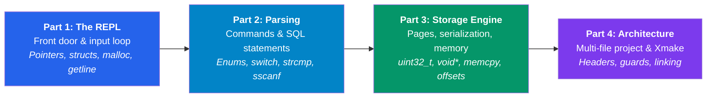

# Building a Database from Scratch in C: A Complete Beginner's Guide

Welcome! If you are learning C (or re-learning it after a long break) and want to understand how software works from the ground up, there is no better project than building your own database.

Databases touch almost every core concept in systems programming:
- **Memory management** (heap allocation, pointers, memory leaks)
- **Data structures & layouts** (structs, byte offsets, packing, serialization)
- **Input & string parsing** (buffers, formats, enums, switch dispatch)
- **Modular software design** (headers, compilation units, include guards, build tools)

This blog series walks through the code of a custom SQLite clone step-by-step. It is written **specifically for readers who do not know C concepts yet** — every data type, operator, memory trick, and architectural choice is explained in plain English with diagrams and real-world analogies.

---

## 📚 The 4-Part Series Overview



### [Part 1 — The REPL: Your Database's Front Door](part1-the-repl.md)
*Estimated read: 15–20 minutes*

Learn how to build an interactive command prompt (`db > `) that safely reads input from the user.
- **Key Concepts Explained:**
  - What `#include` does and how the standard library works
  - Fundamental data types: `char`, `char*` (strings), `size_t`, `ssize_t`, `int`, `bool`
  - Grouping data with `typedef struct`
  - Pointers and memory: Stack vs. Heap, `malloc()`, `free()`, the `->` and `&` operators
  - Dynamic user input with `getline()`
  - The infinite REPL loop (`while (true)`)
  - Constructive critiques: checking for `NULL`, avoiding unnecessary casts, handling EOF (Ctrl+D)

---

### [Part 2 — Parsing Commands: Teaching Your Database to Understand](part2-parsing-commands.md)
*Estimated read: 15–20 minutes*

Transform raw input text like `"insert 1 alice alice@example.com"` into actionable instructions.
- **Key Concepts Explained:**
  - `enum`: giving meaningful names to integer codes
  - Why string equality `==` doesn't work in C, and how `strcmp()` / `strncmp()` work
  - Extracting structured data with `sscanf()`
  - Why some arguments need the address-of operator `&` while others don't (array decay)
  - Dispatching control flow cleanly with `switch`, `case`, `break`, and `continue`
  - Meta-commands (`.exit`) vs. SQL statements (`insert`, `select`)
  - Constructive critiques: preventing buffer overflow in `sscanf`, decoupling `exit()` from parser logic

---

### [Part 3 — Storing Data: Rows, Tables, and Memory](part3-storing-data.md)
*Estimated read: 20–25 minutes*

The heart of the database: storing records in structured memory pages without wasting space.
- **Key Concepts Explained:**
  - Fixed-width integers: why `uint32_t` from `<stdint.h>` is preferred over platform-dependent `int`
  - Defining row schemas (`id`, `username`, `email`) with fixed array buffers (`char[32]`, `char[255]`)
  - The `size_of_attribute` macro trick (`sizeof(((Struct *)0)->Attribute)`)
  - Memory offsets, row packing, and why alignment matters
  - Serialization and deserialization using `void*` and `memcpy()`
  - Organizing memory into 4096-byte (4KB) pages (just like OS virtual memory!)
  - Calculating row slots with integer division and modulo (`row_num / ROWS_PER_PAGE`, `row_num % ROWS_PER_PAGE`)
  - Constructive critiques: replacing header `const` definitions with `#define`, portable pointer arithmetic, robust table deallocation

---

### [Part 4 — Architecture: Organizing Your C Project](part4-architecture.md)
*Estimated read: 15–20 minutes*

Evolving from a single monolithic file into a modular, professional multi-file codebase.
- **Key Concepts Explained:**
  - The separation between Header files (`.h`, the "menu") and Source files (`.c`, the "kitchen")
  - Include guards (`#ifndef` / `#define` / `#endif`) and how they prevent duplicate definitions
  - Declarations vs. Definitions (the One Definition Rule)
  - The C compilation pipeline: source code (`.c`) → object files (`.o`) → linked binary
  - Building with **Xmake** and how incremental compilation saves time
  - The complete project dependency graph and data flow
  - Next milestones: file persistence, B-trees, cursors, and transactions

---

## 🏃 Running the Code

The project uses [Xmake](https://xmake.io), a fast, modern build utility.

### Build
```bash
xmake
```

### Run
```bash
xmake run custom_sql_lite
```

### Try it out!
```text
db > insert 1 alice alice@example.com
Executed.
db > insert 2 bob bob@example.com
Executed.
db > select
(1, alice, alice@example.com)
(2, bob, bob@example.com)
Executed.
db > .exit
```

---

## 💡 How to Read This Series

1. **Don't rush through the memory sections:** C is famous for pointers and memory management. When Part 1 introduces pointers and Part 3 introduces `void*` and `memcpy()`, take time to study the diagrams!
2. **Type the code yourself:** Writing the code by hand builds muscle memory that reading alone cannot match.
3. **Check the "Could This Be Better?" sections:** Every part highlights real-world trade-offs, potential pitfalls, and alternatives so you learn not just *how* it works, but *how to make it production-ready*.

Happy coding! Let's start with **[Part 1: The REPL](part1-the-repl.md)**.
