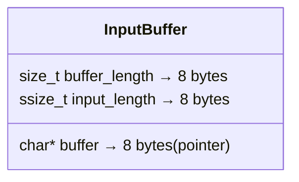
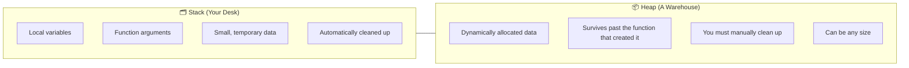
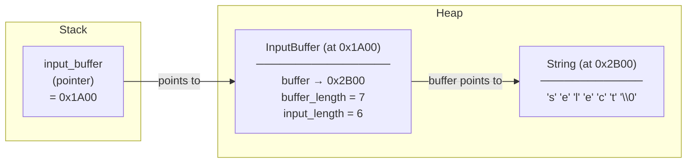
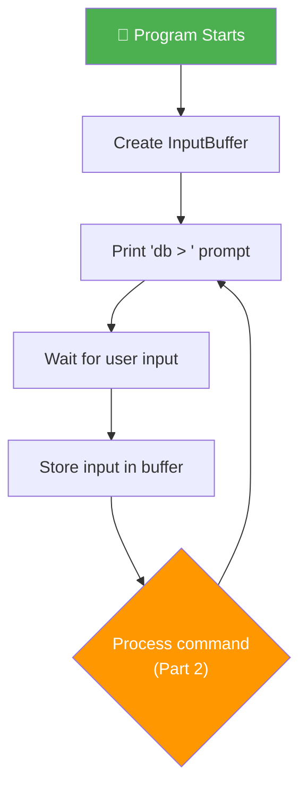

# Part 1 — The REPL: Your Database's Front Door

## What You'll Learn

In this first part of our *Building a Database from Scratch in C* series, you'll learn:

- What a **REPL** is and why every database needs one
- How C projects are structured with **header files** and **source files**
- The fundamental **data types** in C — `char`, `int`, `size_t`, pointers, and more
- How **structs** group related data together (like a mini-class)
- How **pointers and memory** work — the concept that trips up every beginner (we'll make it click)
- How to **read user input** safely using `getline`
- How to build an **infinite loop** that keeps your database running

By the end, you'll have a working interactive prompt that looks like this:

```
db > select
db > insert 1 alice alice@example.com
db > .exit
```

That humble `db > ` prompt is the front door to your entire database. Let's build it.

---

## 1. Introduction — What Is a REPL?

**REPL** stands for **Read-Eval-Print Loop**. It's a pattern you'll find in almost every interactive program:

1. **Read** — Wait for the user to type something
2. **Eval** — Figure out what they meant and do it
3. **Print** — Show them the result
4. **Loop** — Go back to step 1

If you've ever opened a terminal and typed commands, you've used a REPL. Python has one (`>>>`), Node.js has one (`>`), and — most relevant to us — **SQLite** has one:

```
sqlite> SELECT * FROM users;
1|alice|alice@example.com
sqlite>
```

Our database is inspired by SQLite. By the end of this series, we'll have something similar. But today, we're starting with just the prompt — the `db > ` that patiently waits for you to type something:

```
db > 
```

That blinking cursor is your database saying, *"I'm ready. What do you need?"*

> [!NOTE]
> We won't be handling commands in this part — that's Part 2. Today, our goal is simply to **display a prompt**, **read what the user types**, and **loop forever**. Simple? Yes. But the C concepts we'll learn along the way are foundational to everything that follows.

---

## 2. Setting Up the Project

Before we write any C code, we need a way to **compile** it — to turn our human-readable source code into a program the computer can actually run.

We're using **xmake** as our build system. Think of it like a smart assistant that knows how to compile all your C files, link them together, and produce a single executable. You *could* run the compiler manually every time, but that gets tedious fast.

Here's our `xmake.lua` file — the configuration that tells xmake what to build:

```lua
add_rules("mode.debug", "mode.release")
target("custom_sql_lite")
    set_kind("binary")
    add_files("src/*.c")
```

Let's break this down:

| Line | What It Does |
|------|-------------|
| `add_rules("mode.debug", "mode.release")` | Enables two build modes. **Debug** mode includes extra information for finding bugs. **Release** mode optimizes for speed. |
| `target("custom_sql_lite")` | Names our build target. This will be the name of the executable file produced. |
| `set_kind("binary")` | Tells xmake we're building a standalone program (not a library). |
| `add_files("src/*.c")` | Says "compile every `.c` file in the `src/` folder." The `*` is a wildcard — it matches any filename. |

Our project structure looks like this:

```
custom_sql_lite/
├── src/
│   ├── main.c          ← The entry point (contains the REPL loop)
│   ├── input.h         ← Header file: declares what input functions exist
│   └── input.c         ← Source file: defines how those functions work
└── xmake.lua           ← Build configuration
```

> [!TIP]
> To build and run the project, you'd type:
> ```bash
> xmake build
> xmake run
> ```
> xmake takes care of compiling `main.c` and `input.c`, linking them together, and producing the `custom_sql_lite` executable.

---

## 3. The `#include` System — Importing Toolboxes

At the top of our C files, you'll see lines like this:

```c
#include <stdio.h>
#include <stdlib.h>
#include <string.h>
#include <stdbool.h>
#include "input.h"
```

What's going on here?

**`#include`** is C's way of saying *"copy the contents of this file and paste them right here."* It's like importing a toolbox. Before you can use a hammer, you need to bring the toolbox into your workshop.

### Angle Brackets `< >` vs Quotes `" "`

There's an important difference between the two styles:

| Syntax | Meaning | Example |
|--------|---------|---------|
| `#include <stdio.h>` | Look for this file in the **system's standard library folders**. These are files that come pre-installed with your C compiler. | `stdio.h`, `stdlib.h` |
| `#include "input.h"` | Look for this file in **your project's folder first**, then fall back to system folders. These are files *you* wrote. | `input.h` |

Think of it this way: `< >` means "grab a tool from the store," while `" "` means "grab a tool from my own garage."

### What Each Header Provides

Each `.h` file (called a **header file**) declares a set of functions and types you can use:

| Header | What It Gives You | Functions/Types We Use |
|--------|-------------------|----------------------|
| `stdio.h` | **Standard Input/Output** — reading from the keyboard, printing to the screen | `printf()`, `getline()`, `stdin` |
| `stdlib.h` | **Standard Library** — memory management, program control | `malloc()`, `free()`, `exit()`, `EXIT_FAILURE` |
| `string.h` | **String manipulation** — comparing, copying, measuring strings | (Used later in the series for `strcmp()`) |
| `stdbool.h` | **Boolean type** — gives you `true` and `false` | `bool`, `true`, `false` |

> [!NOTE]
> C was created in 1972, long before `true` and `false` were considered essential. That's why booleans aren't built into the language — you need to `#include <stdbool.h>` to get them. Under the hood, `true` is just `1` and `false` is just `0`.

---

## 4. Understanding Data Types in C

Here's where things get interesting. In C, you have to tell the compiler **exactly** what type of data every variable holds. There's no "just figure it out" like in Python or JavaScript.

Why? Because the compiler needs to know **how many bytes** to set aside in memory for each variable. A single character takes 1 byte. An integer takes 4 bytes. If the compiler doesn't know the type, it doesn't know how much space to reserve.

Let's look at every data type used in our `InputBuffer` struct:

```c
typedef struct {
  char *buffer;
  size_t buffer_length;
  ssize_t input_length;
} InputBuffer;
```

That's three fields, using three different types. Let's also cover the other types used elsewhere in our code. Here's the full reference table:

| Type | Size (bytes) | Range | Used For |
|------|-------------|-------|----------|
| `char` | 1 | -128 to 127 (or 0 to 255) | A single character: `'a'`, `'Z'`, `'7'`, `'\0'` |
| `char*` | 8 (on 64-bit systems) | A memory address | A **pointer** to a character — used for strings |
| `int` | 4 (typically) | −2,147,483,648 to 2,147,483,647 | General-purpose whole numbers |
| `size_t` | 8 (on 64-bit systems) | 0 to 18,446,744,073,709,551,615 | Sizes and counts — **cannot be negative** |
| `ssize_t` | 8 (on 64-bit systems) | −9,223,372,036,854,775,808 to 9,223,372,036,854,775,807 | Sizes that might be -1 (to signal an error) |
| `bool` | 1 | `true` (1) or `false` (0) | Yes/no flags and conditions |

Let's walk through each one.

### `char` — A Single Character

A **`char`** holds exactly **1 byte** — enough for a single ASCII character. The letter `'a'` is stored as the number `97`. The letter `'Z'` is `90`. The digit `'0'` (the character, not the number) is `48`.

```c
char letter = 'a';    // Stores the number 97
char newline = '\n';   // A special "escape character" — the newline
char null = '\0';      // The null character — value 0. Very important!
```

> [!IMPORTANT]
> In C, single quotes `'a'` mean **one character**. Double quotes `"a"` mean **a string** (which is secretly an array of characters ending with `'\0'`). They are NOT interchangeable.

### `char*` — A Pointer to Characters (a.k.a. a String)

This is the big one. **`char*`** (pronounced "char pointer" or "char star") is how C handles **strings** — sequences of characters like `"alice"` or `"alice@example.com"`.

But what *is* a pointer? Let's use an analogy.

Imagine you have a friend named Alice. Instead of carrying Alice around with you everywhere (that would be weird and heavy), you carry a **piece of paper with her home address** on it. That piece of paper is a pointer. It doesn't contain Alice — it tells you **where to find** Alice.

In C:
- A `char` variable **contains** a character directly (like carrying Alice herself)
- A `char*` variable **contains the memory address** where a character (or sequence of characters) is stored (like carrying the piece of paper with her address)

The string `"alice"` is stored in memory like this:

| Address | 1000 | 1001 | 1002 | 1003 | 1004 | 1005 |
|---------|------|------|------|------|------|------|
| Value   | `'a'` | `'l'` | `'i'` | `'c'` | `'e'` | `'\0'` |

A `char*` variable pointing to this string would hold the value `1000` — the address of the first character. The string ends with **`'\0'`** (the **null terminator**), which tells C "the string stops here."

> [!CAUTION]
> C strings **must** end with `'\0'`. If you forget the null terminator, functions like `printf` will keep reading memory past your string, printing garbage characters (or crashing your program). This is a real source of bugs — and security vulnerabilities — in C programs.

### `size_t` — Sizes That Can't Be Negative

**`size_t`** is an **unsigned** (non-negative) integer type designed specifically for representing sizes and counts. On a 64-bit system, it's 8 bytes.

Why can't sizes be negative? Well, have you ever had a string that's -5 characters long? A memory block that's -100 bytes? Of course not. Using `size_t` makes this guarantee explicit: the compiler won't even let a `size_t` go negative.

In our struct, `buffer_length` is `size_t` because it tracks **how much memory has been allocated** for our buffer — and that's always zero or positive.

### `ssize_t` — Sizes That *Might* Be Negative (for Errors)

**`ssize_t`** is the **signed** sibling of `size_t`. It can hold the same large positive values, but it can *also* be negative — specifically, **-1**.

Why would you need that? Because many C functions use -1 as a return value to signal "something went wrong." The `getline()` function returns an `ssize_t`: it gives you the number of bytes read (a positive number) or -1 if it encounters an error.

In our struct, `input_length` is `ssize_t` because it stores the result from `getline()`, and we need to be able to check for that -1 error case.

### `int` — The Everyday Integer

**`int`** is C's basic whole-number type. It's typically **4 bytes** and can hold values from about -2 billion to +2 billion. You'll see it everywhere: loop counters, function return values, and — in our database — the `id` field for each row.

```c
int id = 1;
int count = 42;
int error_code = -1;
```

The `main` function returns an `int`: `0` means "everything went fine," and any other number means "something went wrong."

### `bool` — True or False

**`bool`** gives you exactly two values: `true` and `false`. We use it in our REPL's `while (true)` loop to create a loop that runs forever.

```c
#include <stdbool.h>

bool is_running = true;
bool found_user = false;
```

Under the hood, `true` is the integer `1` and `false` is `0`. The `stdbool.h` header just gives them friendlier names.

---

## 5. Structs: Grouping Related Data

Now that we understand the individual types, let's look at how they're combined. Here's our `InputBuffer`:

```c
typedef struct {
  char *buffer;         // The actual text the user typed
  size_t buffer_length; // How much memory is allocated for the buffer
  ssize_t input_length; // How many characters the user actually typed
} InputBuffer;
```

A **`struct`** (short for "structure") is C's way of bundling related variables together into a single package. Think of it like a form with multiple fields — instead of having three loose variables floating around, you group them into one named thing.

### Why Not Just Use Three Separate Variables?

Good question! We *could* write our code like this:

```c
// Without a struct — three loose variables
char *buffer;
size_t buffer_length;
ssize_t input_length;
```

But this falls apart quickly:

| Approach | Pros | Cons |
|----------|------|------|
| Three separate variables | Simple at first | Can't easily pass all three to a function. Can't return all three from a function. Easy to mix up which `buffer_length` goes with which `buffer`. |
| A struct (`InputBuffer`) | Pass one thing to functions. Return one thing from functions. Clear ownership — the length *belongs to* the buffer. | Slightly more code to set up initially. |

When you have two input buffers, the struct version is clean:

```c
InputBuffer *buf1 = new_input_buffer();
InputBuffer *buf2 = new_input_buffer();
// Each buffer carries its own length — no confusion
```

Without a struct, you'd need `buffer1`, `buffer_length1`, `input_length1`, `buffer2`, `buffer_length2`, `input_length2` — a mess.

### The `typedef` Keyword

You might wonder why we write `typedef struct { ... } InputBuffer;` instead of just `struct InputBuffer { ... };`. Both work, but there's a convenience difference:

```c
// Without typedef:
struct InputBuffer my_buf;        // Must write "struct" every time

// With typedef:
InputBuffer my_buf;               // Clean and short
```

**`typedef`** creates an **alias** — a shorter name for a type. It says: *"From now on, when I say `InputBuffer`, I mean this struct."*

### What Does InputBuffer Look Like in Memory?

When we create an `InputBuffer`, the computer lays out its fields one after another in memory:



That's 24 bytes total for one `InputBuffer` (on a 64-bit system). The `buffer` field doesn't contain the string itself — it's a pointer that holds the **address** of where the string lives. The actual string text is stored separately, somewhere else in memory. We'll see exactly where in the next section.

---

## 6. Pointers and Memory — The Most Important Section

This is the section that separates C from every other language you may have used. In Python or JavaScript, memory management is automatic — you never think about it. In C, **you are the memory manager**. You request memory, you use it, and you give it back. Forget to give it back? That's a **memory leak**. Use it after giving it back? That's a **use-after-free bug**. Welcome to C.

But don't be intimidated! Once you understand the model, it's actually quite elegant.

### Stack vs. Heap: Two Kinds of Memory

Your program has access to two regions of memory:



**The Stack** is like your desk at work. It's fast, organized, and automatic. Every time you call a function, local variables get placed on the stack. When the function returns, those variables are automatically swept away.

```c
void some_function() {
    int x = 42;        // x lives on the stack
    char c = 'a';      // c lives on the stack
}   // x and c are GONE when this function returns
```

**The Heap** is like a warehouse. It's bigger, a bit slower, and — critically — **you** are responsible for managing it. You **request** space with `malloc()`, and you **return** it with `free()`. If you forget to return it, that space is wasted for the rest of your program's life.

### `malloc` — Requesting Memory from the Heap

**`malloc`** (short for **m**emory **alloc**ation) asks the operating system for a chunk of memory. You tell it how many bytes you need, and it gives you a **pointer** to that memory.

```c
InputBuffer *input_buffer = (InputBuffer *)malloc(sizeof(InputBuffer));
```

Let's dissect this piece by piece:

| Part | Meaning |
|------|---------|
| `sizeof(InputBuffer)` | "How many bytes does an `InputBuffer` need?" — Returns `24` (on a 64-bit system). |
| `malloc(sizeof(InputBuffer))` | "Give me 24 bytes of heap memory." — Returns a pointer (the address of the allocated block), or `NULL` if the system is out of memory. |
| `(InputBuffer *)` | A **cast** — tells the compiler "treat this pointer as a pointer to an `InputBuffer`." (More on this in the improvements section.) |
| `InputBuffer *input_buffer` | Declares a variable called `input_buffer` that is a **pointer to an InputBuffer**. This pointer itself lives on the stack, but it *points to* data on the heap. |

**The `sizeof` operator** is not a function — it's a built-in keyword that the compiler evaluates at compile time. `sizeof(InputBuffer)` asks: *"How many bytes does one `InputBuffer` struct occupy?"* The compiler adds up the sizes of all the fields (8 + 8 + 8 = 24 bytes) and replaces `sizeof(InputBuffer)` with `24`.

### `free` — Giving Memory Back

When you're done with heap memory, you **must** return it:

```c
free(input_buffer->buffer);  // Free the string memory
free(input_buffer);          // Free the struct memory
```

After calling `free`, that memory is available for the system to reuse. But your pointer variable still holds the old address — it's now a **dangling pointer**. Using it would be like trying to enter a building that's been demolished. Don't do it.

### `NULL` — The "Points to Nothing" Value

**`NULL`** is a special constant that means "this pointer doesn't point to anything." It's the equivalent of a blank piece of paper with no address written on it.

```c
input_buffer->buffer = NULL;  // This pointer doesn't point anywhere yet
```

We initialize our `buffer` to `NULL` because we haven't allocated any string memory yet — `getline()` will do that for us later.

### The `->` Operator: Accessing Members Through a Pointer

When you have a pointer to a struct, you use `->` (the **arrow operator**) to access its fields:

```c
input_buffer->buffer = NULL;
input_buffer->buffer_length = 0;
input_buffer->input_length = 0;
```

The arrow `->` means "follow the pointer to the struct, then access this field." It's shorthand for `(*input_buffer).buffer` — but nobody writes it that way because `->` is much cleaner.

If you had the struct directly (not a pointer), you'd use a dot `.` instead:

```c
InputBuffer buf;        // Direct struct (on the stack)
buf.buffer = NULL;      // Use dot

InputBuffer *ptr;       // Pointer to struct
ptr->buffer = NULL;     // Use arrow
```

### The `&` Operator: Getting an Address

The **`&`** (address-of) operator does the opposite of `*`. While `*` says "follow this address and give me what's there," `&` says "give me the address of this variable."

We'll see it used in `read_input()`:

```c
getline(&(input_buffer->buffer), &(input_buffer->buffer_length), stdin);
```

This passes the **addresses** of `buffer` and `buffer_length` to `getline`, so that `getline` can modify them directly. We'll explain this more when we cover the function.

### The Full Memory Picture

Here's what memory looks like when our REPL is running and the user has typed `"select"`:



Notice the two levels of indirection:

1. `input_buffer` (on the stack) points to the `InputBuffer` struct (on the heap)
2. The struct's `buffer` field points to the actual string (also on the heap, allocated by `getline`)

This is why we need to call `free()` **twice** when cleaning up — once for the string, once for the struct. There are two separate heap allocations.

---

## 7. The Functions Explained

Now let's walk through every function in our input module. We have four of them, and each teaches something important.

### `new_input_buffer()` — The Constructor

This function creates a fresh, empty `InputBuffer` and returns a pointer to it:

```c
InputBuffer *new_input_buffer() {
  InputBuffer *input_buffer = (InputBuffer *)malloc(sizeof(InputBuffer));
  input_buffer->buffer = NULL;
  input_buffer->buffer_length = 0;
  input_buffer->input_length = 0;

  return input_buffer;
}
```

Line by line:

**`InputBuffer *new_input_buffer() {`**
This declares a function called `new_input_buffer` that takes no arguments (the empty parentheses) and returns an `InputBuffer *` — a pointer to an `InputBuffer`. The `*` in the return type means "I'm returning a pointer, not the struct itself."

**`InputBuffer *input_buffer = (InputBuffer *)malloc(sizeof(InputBuffer));`**
This is the memory allocation we discussed in section 6. We're asking for `sizeof(InputBuffer)` bytes (24 bytes) from the heap. The result is stored in a local pointer variable called `input_buffer`.

**`input_buffer->buffer = NULL;`**
Sets the `buffer` field to `NULL`. The buffer pointer doesn't point to any string yet — it's blank. `getline()` will allocate string memory later.

**`input_buffer->buffer_length = 0;`**
The allocated buffer size is 0 because we haven't allocated any string memory yet.

**`input_buffer->input_length = 0;`**
No input has been read yet, so the length of input is 0.

**`return input_buffer;`**
Returns the pointer to the caller. This is why we used `malloc` instead of putting the struct on the stack — if we had declared `InputBuffer input_buffer;` (a local stack variable), it would be destroyed the moment this function returns. By allocating on the heap, the struct **survives** past the function's lifetime.

> [!WARNING]
> This function has a subtle bug: `malloc` can return `NULL` if the system runs out of memory, and we never check for that. We'll fix this in the "Could This Be Better?" section.

**This pattern — a function that allocates and initializes a struct — is called the Constructor Pattern.** C doesn't have classes or constructors like C++ or Java, but we can simulate them with functions like `new_input_buffer()`. It's a convention: the function name starts with `new_` to signal "this allocates memory that you'll need to free later."

### `print_prompt()` — Displaying the Prompt

```c
void print_prompt() { printf("db > "); }
```

Short and sweet. Let's still break it down:

**`void print_prompt()`**
The return type is **`void`**, which means "this function doesn't return anything." It just does something (prints text) and finishes.

**`printf("db > ");`**
**`printf`** (from `stdio.h`) stands for **print formatted**. It sends text to the terminal. The string `"db > "` is what the user sees as the prompt. Notice there's no `\n` (newline) at the end — we *want* the cursor to stay on the same line so the user types their command right after `db > `.

When you run the program, this is what you see:

```
db > █
```

(The `█` represents your blinking cursor, waiting for input.)

### `read_input()` — The Star of the Show

This function reads a line of text from the user's keyboard:

```c
void read_input(InputBuffer *input_buffer) {
  ssize_t bytes_read =
      getline(&(input_buffer->buffer), &(input_buffer->buffer_length), stdin);

  if (bytes_read <= 0) {
    printf("Error reading input\n");
    exit(EXIT_FAILURE);
  }

  input_buffer->input_length = bytes_read - 1;
  input_buffer->buffer[bytes_read - 1] = 0;
}
```

This is the most complex function in Part 1, so let's take it slow.

**`void read_input(InputBuffer *input_buffer) {`**
This function takes a **pointer** to an `InputBuffer` as its argument. It doesn't return anything (`void`), but it modifies the `InputBuffer` that the pointer points to. Since we have a pointer to the struct (not a copy of it), any changes we make here are visible to the caller.

**`ssize_t bytes_read = getline(&(input_buffer->buffer), &(input_buffer->buffer_length), stdin);`**

This is the core of the function. **`getline`** is a powerful function from `stdio.h` that reads an entire line of text from the user. Let's look at its three arguments:

| Argument | What We Pass | What It Means |
|----------|-------------|---------------|
| `&(input_buffer->buffer)` | Address of the `buffer` pointer | `getline` needs to know **where** the buffer pointer is so it can **change it**. If the buffer is `NULL` or too small, `getline` will allocate (or reallocate) memory and update the pointer to point to the new memory. |
| `&(input_buffer->buffer_length)` | Address of `buffer_length` | `getline` updates this with the total size of the allocated buffer. |
| `stdin` | Standard input | This tells `getline` to read from the **keyboard** (standard input). |

The `&` (address-of operator) is crucial here. We're not passing the *values* of `buffer` and `buffer_length` — we're passing their *addresses* so that `getline` can modify them. It's like giving someone the key to your mailbox so they can put something inside, rather than just telling them what's currently in the mailbox.

`getline` returns an `ssize_t`: the number of bytes read (including the newline character `\n`), or -1 if something went wrong.

#### Why `getline` Instead of `scanf` or `fgets`?

| Function | Pros | Cons |
|----------|------|------|
| `scanf` | Simple syntax | **Dangerous**: doesn't limit input length → buffer overflow. Stops at whitespace. |
| `fgets` | Limits input length | You must pre-allocate a fixed-size buffer. If the user types more, it's silently truncated. |
| `getline` ✅ | **Dynamically allocates** memory. Reads the entire line. Handles any input length. | Not available on all systems (POSIX, not ANSI C). |

`getline` is the safest choice because it automatically allocates (or grows) the buffer to fit whatever the user types. No buffer overflow, no truncation.

**`if (bytes_read <= 0) {`**
If `getline` returns 0 or a negative number, something went wrong. Maybe the user pressed **Ctrl+D** (which sends an EOF — End of File — signal) or there was a read error.

**`printf("Error reading input\n");`**
Print an error message. The `\n` at the end creates a newline so the next terminal output starts on a fresh line.

**`exit(EXIT_FAILURE);`**
**`exit()`** immediately terminates the entire program. **`EXIT_FAILURE`** is a constant (defined in `stdlib.h`) that signals to the operating system that our program ended due to an error. It's typically the value `1`. (The success equivalent is `EXIT_SUCCESS`, which is `0`.)

**`input_buffer->input_length = bytes_read - 1;`**
Why subtract 1? Because `getline` counts the **newline character** (`\n`) at the end of the input. When the user types `select` and presses Enter, `getline` actually reads `"select\n"` — 7 characters. We want `input_length` to be `6` (just `"select"` without the newline).

**`input_buffer->buffer[bytes_read - 1] = 0;`**
This replaces the newline character `\n` with `0` (the **null terminator**, equivalent to `'\0'`). This effectively trims the newline off the end of the string.

Before: `['s', 'e', 'l', 'e', 'c', 't', '\n', '\0']`
After:  `['s', 'e', 'l', 'e', 'c', 't', '\0', '\0']`

> [!NOTE]
> In C, the integer `0` and the character `'\0'` are the same thing — both represent the value zero. Writing `0` or `'\0'` is a matter of style. Using `'\0'` makes it clearer to the reader that you're working with strings, but `0` is perfectly valid.

Let's see what happens in practice when the user types `select`:

```
db > select
```

1. `getline` reads `"select\n"` (7 bytes)
2. `bytes_read` = 7
3. `input_length` = 7 - 1 = 6
4. `buffer[6]` (the `\n`) is replaced with `0` (null terminator)
5. `buffer` now contains the clean string `"select"`

### `close_input_buffer()` — The Destructor

```c
void close_input_buffer(InputBuffer *input_buffer) {
  free(input_buffer->buffer);
  free(input_buffer);
}
```

This is the **destructor** — the counterpart to `new_input_buffer()`. It frees all the memory that was allocated.

**`free(input_buffer->buffer);`**
First, we free the string buffer that `getline` allocated. Remember, `getline` calls `malloc` internally to allocate space for the user's input. That memory needs to be freed.

**`free(input_buffer);`**
Then, we free the `InputBuffer` struct itself — the memory we allocated in `new_input_buffer()`.

> [!CAUTION]
> **The order matters!** If we freed the struct first (`free(input_buffer)`), then tried to free the buffer (`free(input_buffer->buffer)`), we'd be accessing `input_buffer` **after** it was freed — a **use-after-free** bug. At best, it crashes. At worst, it silently corrupts your program's memory.
>
> Always free the **inner** allocations first, then the **outer** container.

What happens if we **never** call `close_input_buffer()`? That's a **memory leak**. The memory stays allocated for the entire lifetime of the program, even though nothing is using it. For a small program like ours, it doesn't matter much — the OS reclaims all memory when the program exits. But in long-running programs (like a database server that runs for months!), memory leaks accumulate and can eventually exhaust all available memory.

---

## 8. The REPL Loop

Now let's put it all together. Here's the main function that creates our REPL:

```c
#include <stdbool.h>
#include "input.h"

int main(int argc, char *argv[]) {
  InputBuffer *input_buffer = new_input_buffer();
  while (true) {
    print_prompt();
    read_input(input_buffer);
    // ... (command handling comes in Part 2)
  }
}
```

Let's walk through it:

**`int main(int argc, char *argv[]) {`**
Every C program starts at `main`. It's the entry point — the first function that runs when you launch the program.

- **`int`** — `main` returns an integer to the operating system (0 = success, anything else = error)
- **`argc`** — stands for **arg**ument **c**ount. The number of command-line arguments.
- **`argv`** — stands for **arg**ument **v**ector. An array of strings, one for each argument. `argv[0]` is always the program's own name.

We'll use `argc` and `argv` in later parts when we support specifying a database file name (like `./custom_sql_lite mydb.db`).

**`InputBuffer *input_buffer = new_input_buffer();`**
We create a single `InputBuffer` that will be **reused** for every line of input. We create it once, before the loop, so we don't wastefully allocate a new one every iteration.

**`while (true) {`**
This creates an **infinite loop** — it runs forever (or until the program is explicitly terminated). An infinite loop might sound like a bug, but it's exactly what we want! A database prompt should keep accepting commands forever. The user will eventually type `.exit` (which we'll implement in Part 2) to break out.

**`print_prompt();`**
Display `db > ` on the screen.

**`read_input(input_buffer);`**
Wait for the user to type something and press Enter. The typed text is stored in `input_buffer->buffer`.

Then the loop starts over: print the prompt again, read the next input. Forever.

Here's the REPL cycle visualized:



And here's what it looks like when you run the program:

```
db > hello
db > select
db > insert 1 alice alice@example.com
db > 
```

Right now, the program reads each line but does nothing with it — it just loops back and asks for more input. In Part 2, we'll add the logic to actually *process* these commands.

---

## 9. 🔍 Could This Be Better?

Our code works, but there are a few things a more experienced C developer might improve. Let's go through them.

### Missing NULL Check After `malloc`

`malloc` returns `NULL` if the system can't allocate the requested memory (extremely rare, but possible). Our `new_input_buffer` doesn't check for this. If `malloc` returns `NULL` and we try to access `input_buffer->buffer`, the program crashes with a **segmentation fault**.

Here's the safer version:

```c
InputBuffer *new_input_buffer() {
  InputBuffer *input_buffer = (InputBuffer *)malloc(sizeof(InputBuffer));
  
  if (input_buffer == NULL) {
    printf("Error: Failed to allocate memory for InputBuffer\n");
    exit(EXIT_FAILURE);
  }

  input_buffer->buffer = NULL;
  input_buffer->buffer_length = 0;
  input_buffer->input_length = 0;

  return input_buffer;
}
```

> [!TIP]
> **Rule of thumb**: Every `malloc` should be followed by a `NULL` check. It's like checking if your online order actually arrived before trying to open the box.

### Unnecessary Cast on `malloc`

In our code, we write:

```c
InputBuffer *input_buffer = (InputBuffer *)malloc(sizeof(InputBuffer));
```

That `(InputBuffer *)` is a **cast** — it tells the compiler to treat the `void*` returned by `malloc` as an `InputBuffer*`. In **C**, this cast is **unnecessary**. C automatically converts `void*` to any pointer type.

```c
// This is perfectly valid C:
InputBuffer *input_buffer = malloc(sizeof(InputBuffer));
```

However, in **C++**, the cast *is* required. If you're writing code that might be compiled as C++, the cast doesn't hurt. But in pure C, leaving it off is considered better style because:

1. It's cleaner to read
2. If you accidentally forget to `#include <stdlib.h>`, the compiler will warn you (with the cast, it might silently hide the error)

| Style | When to Use |
|-------|-------------|
| `malloc(sizeof(InputBuffer))` | Pure C code ✅ |
| `(InputBuffer *)malloc(sizeof(InputBuffer))` | C/C++ compatible code, or team convention |

### What Happens on Ctrl+D (EOF)?

When a user presses **Ctrl+D** at the `db > ` prompt, they're sending an **EOF** (End of File) signal. This tells the program "there's no more input coming."

In our code, `getline` returns -1 when it encounters EOF. Our `if (bytes_read <= 0)` check catches this and exits the program with an error message:

```
db > Error reading input
```

This works, but it's not very elegant. Pressing Ctrl+D is a normal, intentional action — not an "error." A better approach would handle it gracefully:

```c
void read_input(InputBuffer *input_buffer) {
  ssize_t bytes_read =
      getline(&(input_buffer->buffer), &(input_buffer->buffer_length), stdin);

  if (bytes_read <= 0) {
    printf("\nGoodbye!\n");   // Friendlier message
    close_input_buffer(input_buffer);  // Clean up memory
    exit(EXIT_SUCCESS);       // Exit normally, not as a failure
  }

  input_buffer->input_length = bytes_read - 1;
  input_buffer->buffer[bytes_read - 1] = 0;
}
```

Now pressing Ctrl+D gives:

```
db > 
Goodbye!
```

Much nicer.

---

## 10. What's Next?

Congratulations! 🎉 You've built the foundation of a database. Right now, our REPL is like a patient receptionist who greets everyone but doesn't know how to actually help yet.

In [**Part 2 — Meta-Commands and Statement Parsing**](part2-parsing-commands.md), we'll teach our database to understand what the user is typing:

- **Meta-commands** like `.exit` — special commands that start with a dot and control the database itself
- **SQL statements** like `insert` and `select` — the commands that actually read and write data
- **Statement parsing** — turning the text `"insert 1 alice alice@example.com"` into structured data our code can work with

Our `db > ` prompt will finally *do something*:

```
db > .exit
Goodbye!
```

```
db > insert 1 alice alice@example.com
Executed.
db > select
(1, alice, alice@example.com)
Executed.
```

The front door is built. Next, we'll furnish the lobby. See you in Part 2! 🚀
