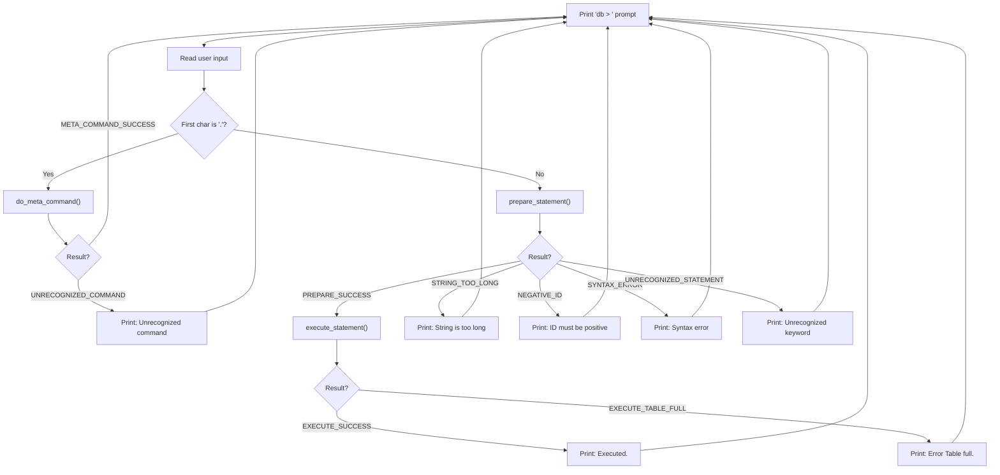

# Part 2 — Parsing Commands: Teaching Your Database to Understand

## What You'll Learn

- What **enums** are and how C uses them to name numbers
- How C compares strings (hint: `==` doesn't work the way you'd think!)
- The difference between `strcmp`, `strncmp`, and `sscanf`
- How `switch` statements work and why `continue` inside a `switch` is different from `break`
- How to parse user input into **meta-commands** (`.exit`) and **SQL statements** (`insert`, `select`)
- Why some function arguments use `&` and others don't
- The full flow of our REPL from raw input to executed command

---

## Introduction

In [Part 1](part1-the-repl.md), we built the skeleton of our database: a **REPL** (Read-Eval-Print Loop) that reads user input into an `InputBuffer` struct. We got `getline()` working, we displayed a `db > ` prompt, and we could type things in.

But here's the problem: our database is like a person who can hear you but doesn't understand any language. It reads your input and then... does absolutely nothing with it.

In this part, we're going to teach our database to **understand** two kinds of commands:

1. **Meta-commands** — special dot-commands like `.exit` that control the database program itself
2. **SQL statements** — commands like `insert` and `select` that work with data

By the end of this post, our database will handle conversations like this:

```
db > .exit
(program exits cleanly)
```

```
db > insert 1 alice alice@example.com
Executed.
db > select
(1, alice, alice@example.com)
Executed.
```

And it will gracefully handle mistakes, too:

```
db > .foobar
Unrecognized command '.foobar'
db > blah
Unrecognized keyword at start of 'blah'.
db > insert
Syntax error. Could not parse statement.
```

Let's make this happen.

---

## Enums: Naming Your Numbers

Before we can parse commands, we need a way to represent the **results** of parsing. Did the command succeed? Was it unrecognized? Was there a syntax error?

We *could* use raw numbers: `0` means success, `1` means error. But what does `2` mean? What about `3`? A month from now, even *you* won't remember what these numbers stand for.

This is where **enums** come in.

### What Is an Enum?

An **enum** (short for **enumeration**) is a way to give **human-readable names** to integer values. Instead of remembering that `0` means "success" and `1` means "unrecognized," you give those numbers names.

Here's our first enum:

```c
typedef enum {
  META_COMMAND_SUCCESS,
  META_COMMAND_UNRECOGNIZED_COMMAND
} MetaCommandResult;
```

Let's break this down piece by piece:

- **`typedef`** — This keyword says: "I'm creating a new type name." Without it, every time you wanted to use this enum, you'd have to write `enum MetaCommandResult`. With `typedef`, you can just write `MetaCommandResult`. It's a convenience that saves typing and makes your code cleaner.

- **`enum`** — This keyword starts the enumeration definition. It tells the compiler: "The following names are really just integers in disguise."

- **`META_COMMAND_SUCCESS`** — This is the first value. C automatically assigns it the integer `0`.

- **`META_COMMAND_UNRECOGNIZED_COMMAND`** — This is the second value. C automatically assigns it `1`.

- **`MetaCommandResult`** — This is the name of our new type. We can now use `MetaCommandResult` as a type, just like we use `int` or `char`.

> [!NOTE]
> C assigns enum values automatically starting from `0` and counting up. So `META_COMMAND_SUCCESS` is `0`, `META_COMMAND_UNRECOGNIZED_COMMAND` is `1`. You can override this (e.g., `META_COMMAND_SUCCESS = 42`), but the automatic numbering is almost always what you want.

### How C Stores Enums

Under the hood, an enum is just an **`int`** (typically 4 bytes). The compiler replaces your named constants with their integer values during compilation. So when you write `META_COMMAND_SUCCESS`, the compiled program actually sees `0`.

Think of enums like **labeled drawers** in a filing cabinet. Instead of saying "open drawer number 0," you say "open the SUCCESS drawer." The drawer is still in position 0 — you've just given it a friendly name.

### Why Not Use #define or Raw Integers?

Let's see what the code would look like **without** enums:

**Option A: Raw integers (bad)**
```c
// What do these numbers mean?! 🤯
int result = do_meta_command(input_buffer, table);
if (result == 0) {
    // success... I think?
} else if (result == 1) {
    // error... maybe?
}
```

**Option B: #define (better, but still not great)**
```c
#define META_COMMAND_SUCCESS 0
#define META_COMMAND_UNRECOGNIZED_COMMAND 1
```

This is better because the names are readable, but `#define` just does text replacement — the compiler doesn't know these values are related. You could accidentally write `#define META_COMMAND_SUCCESS 0` and `#define PREPARE_SUCCESS 0` and mix them up without any warning.

**Option C: Enums (best)**
```c
typedef enum {
  META_COMMAND_SUCCESS,
  META_COMMAND_UNRECOGNIZED_COMMAND
} MetaCommandResult;
```

With enums, the compiler knows that `META_COMMAND_SUCCESS` and `META_COMMAND_UNRECOGNIZED_COMMAND` belong to the same **group** of values. Some compilers will even warn you if you forget to handle one of the cases in a `switch` statement.

### All Our Enums

Our project defines four enums. Here's every one of them:

```c
typedef enum {
  META_COMMAND_SUCCESS,
  META_COMMAND_UNRECOGNIZED_COMMAND
} MetaCommandResult;

typedef enum {
  PREPARE_SUCCESS,
  PREPARE_NEGATIVE_ID,
  PREPARE_STRING_TOO_LONG,
  PREPARE_SYNTAX_ERROR,
  PREPARE_UNRECOGNIZED_STATEMENT
} PrepareResult;

typedef enum { STATEMENT_INSERT, STATEMENT_SELECT } StatementType;

typedef enum { EXECUTE_SUCCESS, EXECUTE_TABLE_FULL } ExecuteResult;
```

Notice that `StatementType` and `ExecuteResult` are written on a single line. That's perfectly fine — C doesn't care about whitespace. When an enum only has a couple of values, some programmers prefer the compact style.

| Enum | Values (Integer) | Purpose |
|------|-------------------|---------|
| `MetaCommandResult` | `META_COMMAND_SUCCESS` (0), `META_COMMAND_UNRECOGNIZED_COMMAND` (1) | Did the meta-command (e.g., `.exit`) work? |
| `PrepareResult` | `PREPARE_SUCCESS` (0), `PREPARE_NEGATIVE_ID` (1), `PREPARE_STRING_TOO_LONG` (2), `PREPARE_SYNTAX_ERROR` (3), `PREPARE_UNRECOGNIZED_STATEMENT` (4) | Was the SQL statement parsed correctly? |
| `StatementType` | `STATEMENT_INSERT` (0), `STATEMENT_SELECT` (1) | What kind of SQL statement is this? |
| `ExecuteResult` | `EXECUTE_SUCCESS` (0), `EXECUTE_TABLE_FULL` (1) | Did the statement execute successfully? |

See the pattern? Each enum represents a **question** about what happened, and each value is a possible **answer**. This makes the code read almost like English: "If the prepare result is `PREPARE_SYNTAX_ERROR`, print a syntax error message."

---

## String Comparison in C

Now that we have enums to represent results, let's talk about how we actually **look at** the user's input to decide what command they typed. This means comparing strings — and C has a major surprise waiting for you.

### Why == Doesn't Work for Strings

In many languages (Python, JavaScript, Java), you compare strings like this:

```python
if command == ".exit":   # Python - this works!
```

In C, this is a **trap**. Let's say you write:

```c
if (input_buffer->buffer == ".exit") {
    // This will NEVER be true! 😱
}
```

Why? Remember from Part 1 that `input_buffer->buffer` is a **`char *`** — a pointer. It holds a **memory address**. The string `".exit"` is *also* stored somewhere in memory at its own address.

When you write `==` between two pointers, C compares the **addresses**, not the contents. It's asking: "Do these two pointers point to the exact same location in memory?" The answer is almost always no, even if both locations contain the same text.

Think of it this way: if two different houses both have a red door, asking "Are these the same house?" (comparing addresses) would say no. You need to ask "Do these houses have the same color door?" (comparing contents).

### strcmp() — Compare Entire Strings

The `strcmp()` function (from `<string.h>`) solves this problem. It compares the actual **characters** of two strings, one by one:

```c
if (strcmp(input_buffer->buffer, ".exit") == 0) {
    // The strings are identical!
}
```

**`strcmp`** stands for **str**ing **c**o**mp**are. Here's how it works:

1. It looks at the first character of each string. Are they the same? If not, stop.
2. Are they the same? Move to the second character. Compare again.
3. Keep going until it finds a difference or reaches the end of both strings.

**Return value:** This is the part that confuses beginners. `strcmp` returns:
- **`0`** if the strings are **equal** (zero differences found)
- A **negative number** if the first string comes before the second alphabetically
- A **positive number** if the first string comes after the second alphabetically

Wait — `0` means equal? Isn't `0` normally "false" in C? Yes! That's why you always see `strcmp(...) == 0` to check for equality. It reads a little strangely, but you'll get used to it. Think of the return value as a "difference score": `0` differences means the strings are the same.

> [!WARNING]
> A very common beginner bug is writing `if (strcmp(a, b))` meaning "if they're equal." But this actually means "if they're NOT equal," because any non-zero value is truthy in C. Always write `if (strcmp(a, b) == 0)` for equality checks.

### strncmp() — Compare the First N Characters

Now, what if the user types `insert 1 alice alice@example.com`? We want to check if the command **starts with** `"insert"`, but the full string includes the arguments too.

`strcmp(input_buffer->buffer, "insert")` would return non-zero because `"insert 1 alice alice@example.com"` is not equal to `"insert"`.

Enter **`strncmp()`** — it compares only the **first N characters**:

```c
if (strncmp(input_buffer->buffer, "insert", 6) == 0) {
    // The first 6 characters are "insert" — this is an insert command!
}
```

The third argument, `6`, is the number of characters to compare. The word "insert" has 6 letters, so we compare exactly 6 characters. The function ignores everything after that.

- **`strncmp`** stands for **str**ing **n**-character **c**o**mp**are.
- The `n` parameter is of type **`size_t`** — an unsigned integer type designed for sizes and counts (we covered this in Part 1).

### sscanf() — Extract Data from a String

Once we know the command is `insert`, we need to **pull out** the individual pieces: the id, username, and email. That's what **`sscanf()`** does.

**`sscanf`** stands for **s**tring **s**can **f**ormatted. It works like `scanf()` (which reads from keyboard input), but it reads from a **string** instead:

```c
int args_assigned = sscanf(
    input_buffer->buffer, "insert %d %s %s",
    &(statement->row_to_insert.id),
    statement->row_to_insert.username,
    statement->row_to_insert.email);
```

Let's break down the **format string** `"insert %d %s %s"`:

- `"insert "` — Match the literal text "insert " at the beginning (including the space after it)
- **`%d`** — Read an integer (**d**ecimal). This will capture `1` from our example input.
- **`%s`** — Read a string (a sequence of non-whitespace characters). The first `%s` captures `alice`.
- **`%s`** — The second `%s` captures `alice@example.com`.

So for the input `"insert 1 alice alice@example.com"`:

| Format specifier | Matches | Stored in |
|---|---|---|
| `insert ` | `"insert "` | (discarded — just matching) |
| `%d` | `1` | `statement->row_to_insert.id` |
| `%s` | `alice` | `statement->row_to_insert.username` |
| `%s` | `alice@example.com` | `statement->row_to_insert.email` |

**Return value:** `sscanf` returns the **number of items successfully matched and assigned**. In our case, if all three (`%d`, `%s`, `%s`) are matched, it returns `3`. If the user just types `"insert"` with no arguments, it returns `0` (or possibly `-1`). We check:

```c
if (args_assigned < 3) {
    return PREPARE_SYNTAX_ERROR;
}
```

If fewer than 3 items were parsed, something is missing — that's a syntax error.

### String Function Comparison Table

| Function | What It Does | When to Use | Example |
|---|---|---|---|
| `strcmp(a, b)` | Compares entire strings `a` and `b` | When you need an **exact** match | `strcmp(buf, ".exit") == 0` |
| `strncmp(a, b, n)` | Compares first `n` characters | When the string has **extra stuff** after the keyword | `strncmp(buf, "insert", 6) == 0` |
| `sscanf(str, fmt, ...)` | Extracts formatted data from a string | When you need to **pull out values** from structured text | `sscanf(buf, "insert %d %s %s", &id, user, email)` |

---

## The switch Statement

Our REPL uses several `switch` statements to handle different outcomes. If you've never seen `switch` before, let's walk through it.

### What Is switch?

A `switch` statement is like a **multi-way branch**. Instead of writing a chain of `if`/`else if`/`else if`, you "switch" on a value and jump directly to the matching `case`:

```c
switch (do_meta_command(input_buffer, table)) {
case (META_COMMAND_SUCCESS):
    continue;
case (META_COMMAND_UNRECOGNIZED_COMMAND):
    printf("Unrecognized command '%s'\n", input_buffer->buffer);
    continue;
}
```

This is equivalent to:

```c
MetaCommandResult result = do_meta_command(input_buffer, table);
if (result == META_COMMAND_SUCCESS) {
    continue;
} else if (result == META_COMMAND_UNRECOGNIZED_COMMAND) {
    printf("Unrecognized command '%s'\n", input_buffer->buffer);
    continue;
}
```

The `switch` version is cleaner, especially when you have many cases. The compiler can also optimize it into a **jump table**, making it faster than a chain of `if` checks.

### break vs continue (Inside a switch Inside a while Loop)

This is one of the trickiest parts of C for beginners. In our code, the `switch` is **inside** a `while (true)` loop. This means:

- **`break`** — Exits the **`switch`** statement. Execution continues with the code **after** the switch, but **still inside** the while loop.
- **`continue`** — Skips the rest of the **while loop body** and jumps back to the top of the loop (the next iteration).

Look at this section of our REPL:

```c
switch (prepare_statement(input_buffer, &statement)) {
case (PREPARE_SUCCESS):
    break;  // Exit the switch, then fall through to execute_statement below
case (PREPARE_SYNTAX_ERROR):
    printf("Syntax error. Could not parse statement.\n");
    continue;  // Skip everything else, go back to "db > " prompt
case (PREPARE_UNRECOGNIZED_STATEMENT):
    printf("Unrecognized keyword at start of '%s'.\n", input_buffer->buffer);
    continue;  // Skip everything else, go back to "db > " prompt
}

// This code only runs if we hit "break" above (PREPARE_SUCCESS)
switch (execute_statement(&statement, table)) {
    ...
}
```

When parsing **succeeds** (`PREPARE_SUCCESS`), we `break` out of the switch and continue to the `execute_statement` switch below — we want to actually run the command.

When parsing **fails** (`PREPARE_SYNTAX_ERROR` or `PREPARE_UNRECOGNIZED_STATEMENT`), we `continue` the while loop — we print an error, skip execution entirely, and go straight back to the `db > ` prompt.

> [!IMPORTANT]
> In C, `break` and `continue` behave differently depending on context. `break` exits the **nearest** `switch` or loop. `continue` skips to the next iteration of the **nearest** loop. When a `switch` is inside a loop, `break` exits the switch (not the loop), while `continue` affects the loop.

### Fall-Through: A Dangerous Default

There's one more thing about `switch` you need to know. In C, if you forget `break` at the end of a `case`, execution **falls through** to the next case:

```c
switch (value) {
case 0:
    printf("zero\n");
    // Oops! No break here!
case 1:
    printf("one\n");  // This runs for BOTH value 0 AND value 1!
    break;
}
```

If `value` is `0`, this prints **both** "zero" and "one"! The execution keeps going until it hits a `break` or the end of the switch. This is almost always a bug, not intentional. Our code always uses either `break` or `continue`, so we're safe.

> [!CAUTION]
> Fall-through in `switch` statements is one of C's most infamous footguns. Always end each `case` with `break`, `continue`, or `return` unless you *intentionally* want fall-through — and if you do, leave a comment like `// fallthrough` so future readers know it's deliberate.

---

## Meta-Commands: The Dot Commands

Let's now look at how our database handles **meta-commands** — those special commands that start with a dot (`.`).

### Why Dot Commands?

Real SQLite has dozens of dot-commands: `.help`, `.tables`, `.schema`, `.quit`, and many more. These are **not** SQL — they're instructions to the database **program itself**. The dot prefix makes them easy to distinguish from SQL statements.

We start small: our only meta-command is `.exit`.

### Detecting a Dot Command

In our main loop, the very first check after reading input is:

```c
if (input_buffer->buffer[0] == '.') {
```

Let's unpack this:

- **`input_buffer->buffer`** is a `char *` (a pointer to the first character of the user's input string).
- **`[0]`** is **array indexing**. Even though `buffer` is a pointer, C lets you use array syntax on pointers. `buffer[0]` means "the character at position 0" — the very first character.
- **`'.'`** is a **character literal**. Single quotes in C denote a single character (type **`char`**, 1 byte). Double quotes `"."` would be a string (type `char *`). We're comparing a single character, so we use single quotes.
- **`==`** works perfectly here because we're comparing two `char` values (two tiny numbers), not two strings. Each `char` is just a 1-byte integer representing an ASCII code. The ASCII code for `'.'` is `46`, so this is really asking "is the first byte equal to 46?"

### Walking Through do_meta_command

```c
MetaCommandResult do_meta_command(InputBuffer *input_buffer, Table *table) {
  if (strcmp(input_buffer->buffer, ".exit") == 0) {
    close_input_buffer(input_buffer);
    free_table(table);
    exit(EXIT_SUCCESS);
  } else {
    return META_COMMAND_UNRECOGNIZED_COMMAND;
  }
}
```

Here's what happens step by step:

**Line 1: `MetaCommandResult do_meta_command(InputBuffer *input_buffer, Table *table)`**

The function returns a `MetaCommandResult` (our enum from earlier). It takes two parameters:
- `InputBuffer *input_buffer` — a pointer to the input buffer containing the user's command
- `Table *table` — a pointer to the database table (we'll explore this in Part 3; for now, just know it represents our data)

**Line 2: `if (strcmp(input_buffer->buffer, ".exit") == 0)`**

We use `strcmp` (not `strncmp`) because `.exit` should be matched **exactly**. If the user types `.exiting` or `.exit please`, we don't want to match. The command is just `.exit`, nothing more.

**Lines 3–5: The cleanup dance**

```c
close_input_buffer(input_buffer);  // Free the input buffer's memory
free_table(table);                 // Free the table's memory
exit(EXIT_SUCCESS);                // Terminate the program
```

When the user asks to exit, we need to be responsible citizens and **clean up** our memory before leaving. `close_input_buffer` frees the memory allocated by `getline()` (from Part 1). `free_table` frees the memory used by our data table. Then we call `exit()`.

**`exit(EXIT_SUCCESS)` vs `exit(EXIT_FAILURE)`**

The `exit()` function (from `<stdlib.h>`) terminates the program immediately. The argument is a **status code** that gets sent back to the operating system:

| Constant | Value | Meaning |
|---|---|---|
| `EXIT_SUCCESS` | `0` | The program finished without errors |
| `EXIT_FAILURE` | `1` | The program encountered an error |

You could write `exit(0)` instead of `exit(EXIT_SUCCESS)`, but the named constant is clearer. If you run a program from the terminal and it exits with a non-zero code, the shell knows something went wrong. This is important for scripting and automation.

**Line 7: `return META_COMMAND_UNRECOGNIZED_COMMAND;`**

If the command doesn't match `.exit` (or any other meta-command we add later), we return `META_COMMAND_UNRECOGNIZED_COMMAND`. Back in `main()`, this triggers the error message:

```c
case (META_COMMAND_UNRECOGNIZED_COMMAND):
    printf("Unrecognized command '%s'\n", input_buffer->buffer);
    continue;
```

> [!NOTE]
> You might have noticed that `do_meta_command` takes a `Table *table` parameter even though it currently only needs it for cleanup during `.exit`. This is forward-thinking design — as we add more meta-commands (like `.btree` to visualize the tree structure), they'll need access to the table.

---

## Preparing Statements: The Parser

Now we get to the heart of this post: **parsing SQL statements**.

### The Two-Phase Approach: Prepare, Then Execute

Our database processes SQL in two steps:

1. **Prepare** (parse): Look at the raw text and figure out what the user wants. Store it in a structured format.
2. **Execute**: Actually do the thing.

Why split it up? Imagine a restaurant:

- The **waiter** takes your order, writes it down on a ticket, and makes sure it makes sense ("We don't serve pizza, sir. This is a sushi restaurant."). This is the `prepare` phase.
- The **chef** reads the ticket and cooks the food. They don't need to talk to the customer — they just follow the ticket. This is the `execute` phase.

This **separation of concerns** is exactly how real databases work. In PostgreSQL and SQLite, the query goes through parsing, planning, and optimization *before* any data is touched. Our version is simpler, but the principle is the same.

### The Statement Struct

The "ticket" that gets passed from the parser to the executor is a **`Statement`** struct:

```c
typedef struct {
  StatementType type;
  Row row_to_insert;
} Statement;
```

- **`StatementType type`** — Is this an `INSERT` or a `SELECT`? (Uses our `StatementType` enum.)
- **`Row row_to_insert`** — If this is an INSERT, what data should be inserted? (The `Row` struct will be detailed in Part 3 — for now, just know it holds an `id`, `username`, and `email`.)

For a `SELECT` statement, we only need `type` — there's no data to store. The `row_to_insert` field is simply ignored.

### Walking Through prepare_insert and prepare_statement

To parse commands cleanly and validate user data, statement preparation is separated into two steps: `prepare_statement` determines the query type, and dedicated helper functions (like `prepare_insert`) parse arguments.

```c
PrepareResult prepare_insert(InputBuffer *input_buffer, Statement *statement) {
  statement->type = STATEMENT_INSERT;

  char *keyword = strtok(input_buffer->buffer, " ");
  char *id_string = strtok(NULL, " ");
  char *username = strtok(NULL, " ");
  char *email = strtok(NULL, " ");

  if (id_string == NULL || username == NULL || email == NULL) {
    return PREPARE_SYNTAX_ERROR;
  }

  int id = atoi(id_string);
  if (id < 0) {
    return PREPARE_NEGATIVE_ID;
  }
  if (strlen(username) > COLUMN_USERNAME_SIZE) {
    return PREPARE_STRING_TOO_LONG;
  }

  statement->row_to_insert.id = id;
  strcpy(statement->row_to_insert.username, username);
  strcpy(statement->row_to_insert.email, email);

  return PREPARE_SUCCESS;
}

PrepareResult prepare_statement(InputBuffer *input_buffer,
                                Statement *statement) {
  if (strncmp(input_buffer->buffer, "insert", 6) == 0) {
    return prepare_insert(input_buffer, statement);
  }
  if (strcmp(input_buffer->buffer, "select") == 0) {
    statement->type = STATEMENT_SELECT;
    return PREPARE_SUCCESS;
  }

  return PREPARE_UNRECOGNIZED_STATEMENT;
}
```

> [!NOTE]
> Notice the call to `strtok()`, `atoi()`, and `strlen()`. Rather than relying on a brittle single-pass `sscanf()`, tokenizing with `strtok` allows explicit validation before copying values into the target `Row`. Also ensure `prepare_statement()` returns the result of `prepare_insert()`.

Let's trace through this with a few different inputs.

**Example 1: Input is `"insert 1 alice alice@example.com"`**

1. `strncmp(input_buffer->buffer, "insert", 6)` matches `"insert"`.
2. `prepare_insert()` is called. `strtok()` splits the string on spaces:
   - `keyword` = `"insert"`
   - `id_string` = `"1"`
   - `username` = `"alice"`
   - `email` = `"alice@example.com"`
3. None of the tokens are `NULL`.
4. `atoi("1")` converts `"1"` to integer `1` (positive, passes check).
5. `strlen("alice")` is 5 (<= `COLUMN_USERNAME_SIZE`, passes check).
6. Fields are copied into `statement->row_to_insert`.
7. Returns `PREPARE_SUCCESS`. ✅

**Example 2: Input is `"insert -5 alice alice@example.com"`**

1. `strncmp` matches `"insert"`.
2. In `prepare_insert()`, `atoi("-5")` yields `-5`.
3. The check `if (id < 0)` catches the negative number.
4. Returns `PREPARE_NEGATIVE_ID`. ❌

**Example 3: Input is `"insert"` (missing fields)**

1. `strncmp` matches `"insert"`.
2. First call to `strtok` gives `"insert"`, but subsequent calls return `NULL`.
3. The check `id_string == NULL || username == NULL || email == NULL` triggers.
4. Returns `PREPARE_SYNTAX_ERROR`. ❌

**Example 4: Input is `"select"`**

1. `strncmp(..., "insert", 6)` fails.
2. `strcmp(input_buffer->buffer, "select")` matches exactly!
3. `statement->type = STATEMENT_SELECT`.
4. Returns `PREPARE_SUCCESS`. ✅

**Example 5: Input is `"blah"`**

1. Fails both "insert" and "select".
2. Falls through to the end: returns `PREPARE_UNRECOGNIZED_STATEMENT`. ❌

**Why `strncmp` for insert but `strcmp` for select?**

- **`insert`** has arguments after it: `insert 1 alice alice@example.com`. We can't use `strcmp` because the full string is much longer than just `"insert"`. We use `strncmp` with `6` to check only the first 6 characters.
- **`select`** (in our simple database) has no arguments. The user types exactly `"select"` and nothing more. So `strcmp` for an exact match works perfectly.

---

## Tokenizing vs Parsing with `sscanf`: Why We Evolved

Earlier, we looked at `sscanf()` as an easy way to parse inputs. But notice how in `prepare_insert` we transitioned to `strtok()` and manual validation.

### Why `sscanf` with `%s` Is Risky
When you run:
```c
// An earlier approach:
sscanf(input_buffer->buffer, "insert %d %s %s", ...);
```
The `%s` format specifier has no default boundary guard. If someone submits an enormous username, `sscanf` continues writing past the bounds of your buffer.

### How `strtok` + `strlen` Solves This
By tokenizing:
```c
char *username = strtok(NULL, " ");
if (strlen(username) > COLUMN_USERNAME_SIZE) {
    return PREPARE_STRING_TOO_LONG;
}
```
We inspect the token **before** copying it into `statement->row_to_insert.username` using `strcpy()`, protecting our database from corrupting adjacent memory.

---

## Memory Addresses, Arrays, and Pointers in Action

Whether using `sscanf` or inspecting struct pointers in `prepare_insert`, you frequently encounter expressions like:
```c
statement->row_to_insert.id = id;
strcpy(statement->row_to_insert.username, username);
```

Notice:
- `statement->row_to_insert.id` is a scalar `uint32_t`.
- `statement->row_to_insert.username` is a `char[COLUMN_USERNAME_SIZE + 1]` array.

In C, passing an array name (like `statement->row_to_insert.username`) to `strcpy()` automatically "decays" into a pointer to its first character (`char*`), so no `&` address-of operator is needed. But when referencing a scalar directly in functions that expect a pointer, you must use `&`.

> [!TIP]
> When in doubt about whether to use `&` with `scanf`/`sscanf`, ask yourself: "Is this variable already a pointer (or an array)?" If yes, no `&`. If it's a plain value type (`int`, `float`, `uint32_t`, `char`), use `&`.

---

## The Full REPL Flow

Now let's zoom out and see how **everything fits together** in our `main()` function. Here it is in its entirety:

```c
int main(int argc, char *argv[]) {
  Table *table = new_table();
  InputBuffer *input_buffer = new_input_buffer();

  while (true) {
    print_prompt();
    read_input(input_buffer);
    if (input_buffer->buffer[0] == '.') {
      switch (do_meta_command(input_buffer, table)) {
      case (META_COMMAND_SUCCESS):
        continue;
      case (META_COMMAND_UNRECOGNIZED_COMMAND):
        printf("Unrecognized command '%s'\n", input_buffer->buffer);
        continue;
      }
    }
    Statement statement;
    switch (prepare_statement(input_buffer, &statement)) {
    case (PREPARE_SUCCESS):
      break;
    case (PREPARE_STRING_TOO_LONG):
      printf("String is too long.\n");
      continue;
    case (PREPARE_NEGATIVE_ID):
      printf("ID must be positive.\n");
      continue;
    case (PREPARE_SYNTAX_ERROR):
      printf("Syntax error. Could not parse statement.\n");
      continue;
    case (PREPARE_UNRECOGNIZED_STATEMENT):
      printf("Unrecognized keyword at start of '%s'.\n", input_buffer->buffer);
      continue;
    }

    switch (execute_statement(&statement, table)) {
    case (EXECUTE_SUCCESS):
      printf("Executed.\n");
      break;
    case (EXECUTE_TABLE_FULL):
      printf("Error: Table full.\n");
      break;
    }
  }
}
```

Let's walk through each piece:

**Lines 2–3: Initialization**
```c
Table *table = new_table();
InputBuffer *input_buffer = new_input_buffer();
```

Before the loop starts, we create two things:
- A `Table` — this is where our data will live (more in Part 3)
- An `InputBuffer` — the buffer that holds user input (from Part 1)

Both are allocated on the heap (using `malloc` inside those functions) and we get pointers back.

**Lines 5–7: The Loop & Reading Input**
```c
while (true) {
    print_prompt();
    read_input(input_buffer);
```

Our infinite loop: print `db > `, read whatever the user types.

**Lines 8–14: Meta-Command Branch**
```c
if (input_buffer->buffer[0] == '.') {
    switch (do_meta_command(input_buffer, table)) {
    case (META_COMMAND_SUCCESS):
        continue;
    case (META_COMMAND_UNRECOGNIZED_COMMAND):
        printf("Unrecognized command '%s'\n", input_buffer->buffer);
        continue;
    }
}
```

If the first character is `.`, treat it as a meta-command. Both cases use `continue`, which means: "Go back to the top of the `while` loop. Print a new prompt and read new input." Meta-commands never fall through to the SQL processing below.

**Line 16: Declaring the Statement**
```c
Statement statement;
```

This declares a `Statement` variable **on the stack** (not the heap — no `malloc`). The stack variable is created fresh each iteration of the loop. We're going to pass its address to `prepare_statement` so it can fill in the fields.

**Lines 17–25: The Prepare Phase**
```c
switch (prepare_statement(input_buffer, &statement)) {
case (PREPARE_SUCCESS):
    break;
case (PREPARE_SYNTAX_ERROR):
    printf("Syntax error. Could not parse statement.\n");
    continue;
case (PREPARE_UNRECOGNIZED_STATEMENT):
    printf("Unrecognized keyword at start of '%s'.\n", input_buffer->buffer);
    continue;
}
```

Notice the crucial difference: `PREPARE_SUCCESS` uses **`break`** (exit the switch, continue to execute), while the error cases use **`continue`** (skip execution, go back to prompt).

**Lines 27–33: The Execute Phase**
```c
switch (execute_statement(&statement, table)) {
case (EXECUTE_SUCCESS):
    printf("Executed.\n");
    break;
case (EXECUTE_TABLE_FULL):
    printf("Error: Table full.\n");
    break;
}
```

We only reach this code if preparation succeeded. We pass the parsed `statement` and the `table` to `execute_statement`. Both cases use `break` here — after executing (successfully or not), we just fall out of the switch and loop back to the top naturally.

### The Complete Flow as a Diagram

Here's the full decision tree of our REPL:



Every path eventually loops back to the prompt — except `.exit`, which terminates the program entirely from inside `do_meta_command`.

---

## 🔍 Could This Be Better?

Our parser works, but there are a few rough edges worth discussing. Real-world code would address these, and we will too as our database matures.

### 1. Returning Results from `prepare_statement` & Validating Lengths

In our implementation of `prepare_statement()`, we check:
```c
if (strncmp(input_buffer->buffer, "insert", 6) == 0) {
  return prepare_insert(input_buffer, statement); // Always return the enum result!
}
```
> [!WARNING]
> Ensure you explicitly `return prepare_insert(...)`! Calling `prepare_insert(input_buffer, statement);` without a `return` statement in a non-void function leads to undefined behavior.

Also, notice how `prepare_insert` checks `strlen(username) > COLUMN_USERNAME_SIZE`. We should also validate `strlen(email) > COLUMN_EMAIL_SIZE` to keep email strings just as safely guarded.

> [!CAUTION]
> Buffer overflows are one of the most dangerous bugs in C. They can crash your program, corrupt data, or — in the worst case — allow attackers to execute arbitrary code. Always validate input lengths.

### 2. The Prepare/Execute Split Is Good Design

One thing we did *right*: separating parsing from execution. This mirrors how real databases work:

```
SQL Text → Parser → Planner/Optimizer → Executor
```

Our version is simpler (no optimizer yet), but the architecture is sound. When we add features like `WHERE` clauses or `JOIN`s in the future, this separation will make it much easier to evolve the system. Each phase can be modified independently.

### 3. do_meta_command Calls exit() Directly

Right now, `do_meta_command` calls `exit(EXIT_SUCCESS)` when it sees `.exit`. This works, but it has a downside: **it's hard to test**.

In an automated test, you don't want the test program to terminate when it runs `.exit`. A cleaner approach would be to return a special value (like a `META_COMMAND_EXIT` enum value) and let `main()` handle the actual exit:

```c
// Better approach:
typedef enum {
  META_COMMAND_SUCCESS,
  META_COMMAND_EXIT,  // new!
  META_COMMAND_UNRECOGNIZED_COMMAND
} MetaCommandResult;

MetaCommandResult do_meta_command(InputBuffer *input_buffer, Table *table) {
  if (strcmp(input_buffer->buffer, ".exit") == 0) {
    return META_COMMAND_EXIT;
  }
  return META_COMMAND_UNRECOGNIZED_COMMAND;
}
```

Then in `main()`:

```c
case (META_COMMAND_EXIT):
    close_input_buffer(input_buffer);
    free_table(table);
    return EXIT_SUCCESS;  // return from main instead of exit()
```

We'll keep the simpler version for now, but remember: functions that call `exit()` directly are a code smell in larger projects.

---

## What's Next

We can now **read** input, **parse** it into structured commands, and **route** it to the right handler. But where does the data actually *go*? When you type `insert 1 alice alice@example.com`, where does that row live in memory?

In [**Part 3 — Storing Data: Rows, Tables, and Memory**](part3-storing-data.md), we'll dive into the **storage engine**: how we define rows and tables, how we serialize data into raw bytes, and how we pack rows into pages of memory. We'll see the `Row` struct up close, build a `Table` that can hold thousands of rows, and understand how real databases think about memory layout.

It's where things get really interesting. See you there! 🚀
