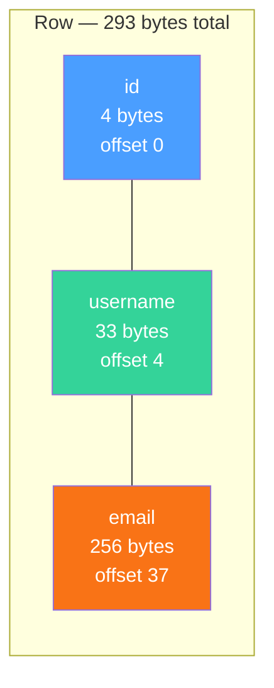
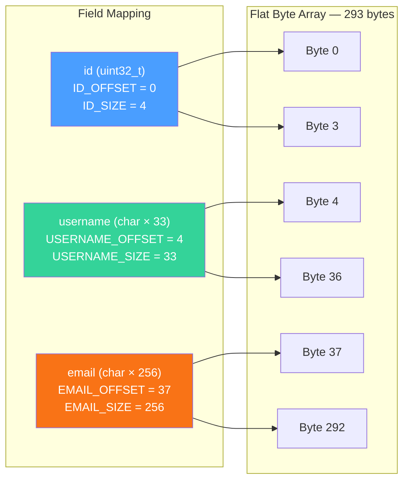
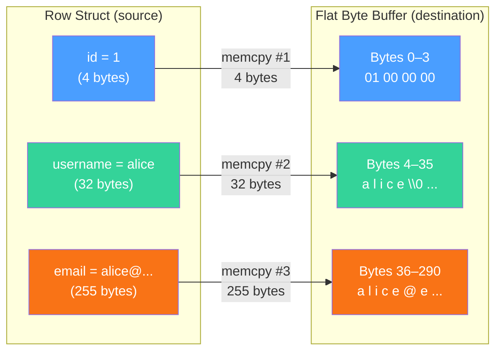
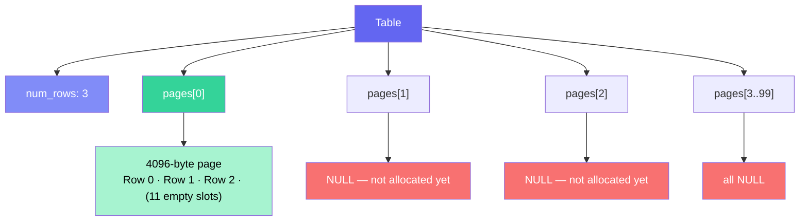
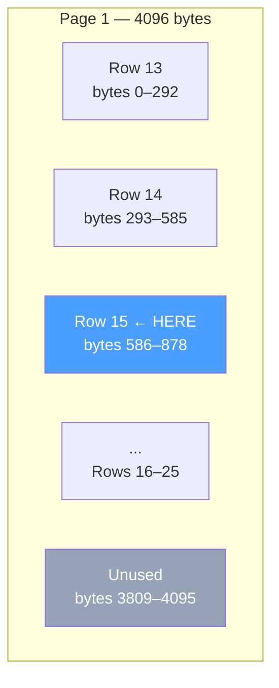
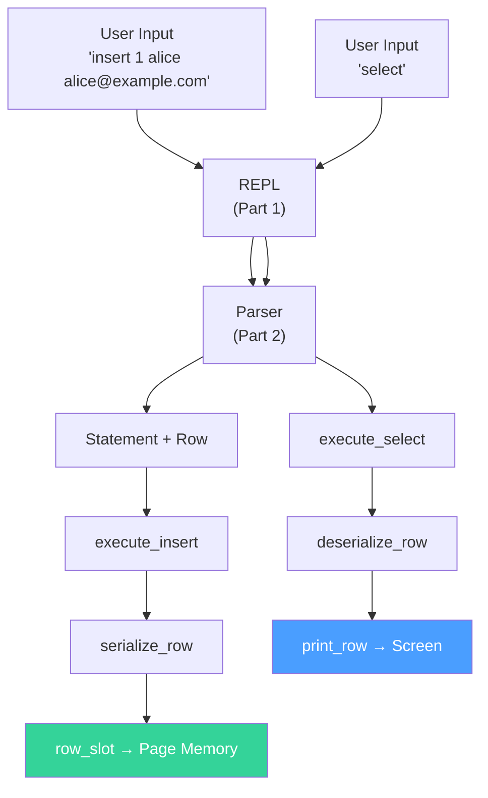

# Part 3 — Storing Data: Rows, Tables, and Memory

## What You'll Learn

In this part, you'll learn:

- How to define a **data schema** using C structs
- Why databases use **fixed-width integers** like `uint32_t` instead of `int`
- How to **serialize** a struct into raw bytes (and deserialize it back)
- How **memory pages** organize rows like chapters in a book
- How to find the exact memory address where any row lives
- How `malloc` and `free` manage your table's lifetime

This is the meatiest part of our series so far. We're building the **storage engine** — the beating heart of any database. By the end, you'll have a working system that can insert rows and retrieve them.

---

## 1. Introduction — Where Does the Data Go?

In [Part 1](part1-the-repl.md), we built a REPL that reads user input. In [Part 2](part2-parsing-commands.md), we taught our database to *understand* commands — parsing `insert` and `select` into structured representations.

But here's the thing: our database can *understand* the command `insert 1 alice alice@example.com`, but it has nowhere to actually *put* Alice's data. It's like having a librarian who knows how to read book titles but has no shelves.

Time to build the shelves.

By the end of this part, our database will do this:

```
db > insert 1 alice alice@example.com
Executed.
db > insert 2 bob bob@example.com
Executed.
db > select
(1, alice, alice@example.com)
(2, bob, bob@example.com)
Executed.
```

Real data going in, real data coming out. Let's make it happen.

---

## 2. Fixed-Width Integers: `uint32_t`

Before we design our storage, we need to talk about a subtle but critical problem with the `int` type in C.

### The Problem with `int`

You might think an `int` is always 4 bytes. On your Mac or modern PC, it probably is. But the C standard only guarantees that `int` is *at least* 16 bits (2 bytes). On some embedded systems or older architectures, `int` could be 2 bytes. On others, it might be 8.

Why does this matter for a database? Imagine you save data on a computer where `int` is 4 bytes, then try to read it on a machine where `int` is 2 bytes. Your data would be **corrupted** — the computer would read the wrong number of bytes and misinterpret everything.

Databases need to know **exactly** how many bytes each piece of data takes. No surprises. No ambiguity.

### Enter `uint32_t` — The Exact-Size Integer

C provides a header file called `<stdint.h>` that gives us **fixed-width integer types** — types that are guaranteed to be an exact size, everywhere, always.

```c
#include <stdint.h>

uint32_t id = 42;  // Exactly 4 bytes, always. Guaranteed.
```

Let's break down the name `uint32_t`:

| Part | Meaning |
|------|---------|
| `u` | **Unsigned** — no negative numbers (0 and up) |
| `int` | It's an integer |
| `32` | Exactly **32 bits** (4 bytes) |
| `_t` | A naming convention meaning "this is a type" |

So `uint32_t` is an unsigned integer that is always exactly 32 bits (4 bytes), no matter what computer you're on. It can hold values from **0 to 4,294,967,295** (about 4.3 billion).

### The Full Family of Fixed-Width Types

Here's the complete family from `<stdint.h>`:

| Type | Signed? | Size (bytes) | Size (bits) | Range |
|------|---------|:------------:|:-----------:|-------|
| `uint8_t` | Unsigned | 1 | 8 | 0 to 255 |
| `int8_t` | Signed | 1 | 8 | −128 to 127 |
| `uint16_t` | Unsigned | 2 | 16 | 0 to 65,535 |
| `int16_t` | Signed | 2 | 16 | −32,768 to 32,767 |
| `uint32_t` | Unsigned | 4 | 32 | 0 to 4,294,967,295 |
| `int32_t` | Signed | 4 | 32 | −2,147,483,648 to 2,147,483,647 |
| `uint64_t` | Unsigned | 8 | 64 | 0 to 18,446,744,073,709,551,615 |
| `int64_t` | Signed | 8 | 64 | −9.2 × 10¹⁸ to 9.2 × 10¹⁸ |

### Why `uint32_t` for Our ID?

Two reasons:

1. **No negative IDs.** A database row ID is never -5. Using `uint32_t` (unsigned) instead of `int32_t` (signed) means we get the full range of positive numbers — about 4.3 billion possible IDs instead of about 2.1 billion.

2. **Exact size guarantee.** When we serialize a row to raw bytes, we need to know that the ID is *always* 4 bytes. Not "probably 4 bytes." *Always.*

> [!TIP]
> Whenever you're storing data in a binary format — files, network packets, databases — use fixed-width types from `<stdint.h>`. The regular `int`, `short`, and `long` types are fine for loop counters and local variables, but not for persistent storage.

---

## 3. The Row Struct: Your Data Schema

In a real database like SQLite or PostgreSQL, you'd run `CREATE TABLE` to define your schema. We're keeping things simpler — our schema is hardcoded as a C struct:

```c
#define COLUMN_USERNAME_SIZE 32
#define COLUMN_EMAIL_SIZE 255

typedef struct {
  uint32_t id;
  char username[COLUMN_USERNAME_SIZE + 1];
  char email[COLUMN_EMAIL_SIZE + 1];
} Row;
```

This defines what a single row in our database looks like. Let's examine every part.

### The `#define` Preprocessor Macros

```c
#define COLUMN_USERNAME_SIZE 32
#define COLUMN_EMAIL_SIZE 255
```

A **`#define`** is a **preprocessor macro**. Before the compiler even looks at your code, a program called the **preprocessor** runs through the file and does text replacement. Everywhere it sees `COLUMN_USERNAME_SIZE`, it replaces it with `32`. Everywhere it sees `COLUMN_EMAIL_SIZE`, it replaces it with `255`.

Think of `#define` like "Find and Replace" in a text editor — it's a purely textual substitution that happens before compilation.

Why not just write `32` and `255` directly? Because if you later want to change the username limit from 32 to 64 characters, you'd have to hunt through your entire codebase to find every `32` that refers to the username size (and not accidentally change a different `32`). With `#define`, you change it in one place.

Here's how the three ways to define constants in C compare:

| Approach | When It's Resolved | Has a Type? | Can Be Used in Array Sizes? | Memory Used? |
|----------|-------------------|-------------|----------------------------|-------------|
| `#define FOO 32` | Preprocessor (text replacement) | No | Yes ✅ | None |
| `const int FOO = 32;` | Compile time | Yes (`int`) | It depends ⚠️ | May use memory |
| `enum { FOO = 32 };` | Compile time | Yes (`int`) | Yes ✅ | None |

For simple numeric constants like buffer sizes, `#define` is the most common choice in C. You'll see it everywhere in system code, the Linux kernel, SQLite, and more.

### The Fields Inside `Row`

Now let's look at the three fields:

#### `uint32_t id` — 4 bytes

We just covered `uint32_t`. This field stores the row's unique identifier. It takes exactly 4 bytes.

#### `char username[COLUMN_USERNAME_SIZE + 1]` — 33 bytes

This is a **fixed-size character array**. We allocate `COLUMN_USERNAME_SIZE + 1` (33 bytes) so a username can store up to 32 visible characters plus a null terminator (`\0`). It always occupies exactly 33 bytes in memory, regardless of how long the actual username is. If the username is `"alice"` (5 characters + 1 null terminator = 6 bytes), the remaining 27 bytes are just sitting there, unused.

This might seem wasteful, but it's a deliberate design choice. Here's why:

> [!IMPORTANT]
> **Why fixed-size arrays instead of pointers?**
>
> In a database, we need to know *exactly* how many bytes each row takes. If every row is exactly 293 bytes, we can calculate where row #500 lives with simple math. If rows were variable-sized, we'd need a much more complex system to find any given row.

Let's compare the two approaches:

| Feature | `char username[33]` (Fixed Array) | `char *username` (Pointer) |
|---------|----------------------------------|---------------------------|
| Size in struct | Always 33 bytes | 8 bytes (just the pointer) |
| Actual data | Stored **inside** the struct | Stored **somewhere else** in memory |
| Total row size | Predictable, constant | Variable, depends on string length |
| Serialization | Simple — just copy the bytes | Complex — must follow the pointer |
| Memory efficiency | Wastes space for short strings | More efficient for variable lengths |

Think of it this way: `char username[33]` is like a box with a fixed size — the name is written *inside* the box. `char *username` is like a slip of paper with an address on it — the actual name is stored at that address, somewhere else. When we need to pack rows tightly into pages, having everything *inside the box* makes life much simpler.

#### `char email[COLUMN_EMAIL_SIZE + 1]` — 256 bytes

Same idea as username, but bigger. The `+ 1` guarantees room for 255 visible characters plus the trailing null terminator (`\0`).

### Total Row Size

Let's add it up:

| Field | Type | Size (bytes) |
|-------|------|:------------:|
| `id` | `uint32_t` | 4 |
| `username` | `char[33]` | 33 |
| `email` | `char[256]` | 256 |
| **Total** | | **293** |

Every single row in our database is exactly **293 bytes**. No exceptions.

### Row Memory Layout

Here's how a single `Row` looks in memory:



---

## 4. The `size_of_attribute` Macro

Now we encounter one of the trickiest lines in our codebase:

```c
#define size_of_attribute(Struct, Attribute) sizeof(((Struct *)0)->Attribute)
```

This is a **macro** that tells us the size (in bytes) of any field inside any struct. Don't panic — let's peel it apart layer by layer.

### Step-by-Step Breakdown

Reading from the inside out:

**Step 1: `(Struct *)0`**

This takes the number `0` (which represents **NULL**, a.k.a. "no address" / "nothing") and casts it to a pointer of type `Struct`. We're telling the compiler: *"Pretend there's a `Struct` sitting at memory address 0."*

There isn't actually a struct there! We're just tricking the compiler so we can talk about the struct's fields.

**Step 2: `((Struct *)0)->Attribute`**

The `->` operator accesses a field through a pointer. So this says: *"From the imaginary struct at address 0, give me the `Attribute` field."*

**Step 3: `sizeof(...)`**

The `sizeof` operator returns the size of something in bytes. Crucially, `sizeof` is evaluated **at compile time** — the compiler figures out the size just by looking at the type. No code actually runs, no memory is accessed. The "imaginary struct at address 0" is never actually touched.

**Step 4: The whole thing**

So `sizeof(((Struct *)0)->Attribute)` means: *"Tell me how many bytes the `Attribute` field of `Struct` takes."*

> [!NOTE]
> This trick is perfectly safe because `sizeof` is a **compile-time** operator. The compiler only needs to know the *type* of the expression, not its *value*. No pointer is actually dereferenced, no memory at address 0 is touched.

### How It's Used

```c
const uint32_t ID_SIZE = size_of_attribute(Row, id);           // → 4
const uint32_t USERNAME_SIZE = size_of_attribute(Row, username); // → 33
const uint32_t EMAIL_SIZE = size_of_attribute(Row, email);       // → 256
```

After macro expansion, the compiler sees:

```c
const uint32_t ID_SIZE = sizeof(((Row *)0)->id);           // → sizeof(uint32_t)   → 4
const uint32_t USERNAME_SIZE = sizeof(((Row *)0)->username); // → sizeof(char[33])   → 33
const uint32_t EMAIL_SIZE = sizeof(((Row *)0)->email);       // → sizeof(char[256])  → 256
```

### Why Not Just Write the Numbers?

You *could* write:

```c
const uint32_t ID_SIZE = 4;
const uint32_t USERNAME_SIZE = 33;
const uint32_t EMAIL_SIZE = 256;
```

But what if you later change `id` from `uint32_t` to `uint64_t`? You'd need to remember to update `ID_SIZE` from `4` to `8`. With the macro, it updates automatically. This is the **DRY principle** — Don't Repeat Yourself.

### 🔍 Could This Be Better? `const` Variables in Headers

The current code defines these sizes as `const` variables in the header file:

```c
// In statement.h — this is problematic!
const uint32_t ID_SIZE = size_of_attribute(Row, id);
const uint32_t USERNAME_SIZE = size_of_attribute(Row, username);
// ...
```

This creates a subtle problem. Every `.c` file that `#include`s this header gets its **own copy** of these variables. If you have 5 source files including `statement.h`, you get 5 copies of `ID_SIZE`, 5 copies of `USERNAME_SIZE`, and so on. With some compilers and linker configurations, this can cause **duplicate symbol errors**.

The better approach is to use `#define`:

```c
// Better — these are compile-time constants with no storage
#define ID_SIZE sizeof(((Row *)0)->id)
#define USERNAME_SIZE sizeof(((Row *)0)->username)
#define EMAIL_SIZE sizeof(((Row *)0)->email)
#define ID_OFFSET 0
#define USERNAME_OFFSET (ID_OFFSET + ID_SIZE)
#define EMAIL_OFFSET (USERNAME_OFFSET + USERNAME_SIZE)
#define ROW_SIZE (ID_SIZE + USERNAME_SIZE + EMAIL_SIZE)
```

With `#define`, no variables are created — the values are substituted directly into the code at each use site. No duplication, no linker issues.

---

## 5. Memory Layout and Offsets

Now we need to know where each field starts within a row's raw byte representation. These are called **offsets** — the number of bytes from the beginning of the row to the start of each field.

```c
const uint32_t ID_OFFSET = 0;
const uint32_t USERNAME_OFFSET = ID_OFFSET + ID_SIZE;       // 0 + 4  = 4
const uint32_t EMAIL_OFFSET = USERNAME_OFFSET + USERNAME_SIZE; // 4 + 33 = 37
const uint32_t ROW_SIZE = ID_SIZE + USERNAME_SIZE + EMAIL_SIZE; // 4 + 33 + 256 = 293
```

### Why Do Offsets Matter?

When we serialize a `Row` struct into raw bytes (we'll see this next), we need to know exactly where to put each piece of data. Think of it like packing a suitcase with labeled compartments:

- Bytes 0–3: The ID goes here
- Bytes 4–36: The username goes here
- Bytes 37–292: The email goes here

### Visual Memory Layout

Imagine a single row as a strip of 293 bytes:



Here's a more concrete picture. Suppose we store the row `(1, "alice", "alice@example.com")`:

```
Byte:  0  1  2  3  | 4  5  6  7  8  9 ... 36 | 37 38 39 40 ...           292
       ─────────── | ──────────────────────── | ─────────────────────────────
Data:  01 00 00 00 | a  l  i  c  e  \0 ... \0 | a  l  i  c  e  @  e  ... \0
       └─ id = 1 ─┘ └──── username ─────────┘  └──────── email ───────────┘
```

> [!NOTE]
> The `id` value `1` is stored as `01 00 00 00` (4 bytes) because most modern computers use **little-endian** byte order — the least significant byte comes first. On a big-endian machine, it would be `00 00 00 01`. This is handled automatically by `memcpy`; we don't need to worry about it for now.

### Other Constants

```c
const uint32_t PAGE_SIZE = 4096;
const uint32_t ROWS_PER_PAGE = PAGE_SIZE / ROW_SIZE;     // 4096 / 293 = 13
const uint32_t TABLE_MAX_ROWS = ROWS_PER_PAGE * TABLE_MAX_PAGES; // 13 * 100 = 1300
```

We'll discuss pages shortly, but note that **integer division truncates** in C. `4096 / 293` is `13.97...`, but since both operands are integers, C drops the decimal part and gives us `13`. That means each page holds exactly 13 rows, with `4096 - (13 × 293) = 4096 - 3809 = 287` bytes of unused space at the end of each page. A small price to pay for simplicity.

---

## 6. Serialization: Struct → Bytes

Now we get to one of the most important operations in our storage engine: **serialization**.

### What Is Serialization?

**Serialization** is the process of converting structured data (our nice, organized `Row` struct with named fields) into a flat sequence of raw bytes. **Deserialization** is the reverse — taking raw bytes and reconstructing the struct.

Why do we need this? Because our table stores rows as raw byte arrays in memory pages, not as `Row` structs. This flat format makes it easy to write rows to disk later (in a future part) and ensures rows are packed tightly together with no gaps.

Think of it like this: a `Row` struct is like a labeled filing cabinet with drawers for "id," "username," and "email." Serialization is taking everything out of the drawers and laying it flat in a single line, in a known order.

### Understanding `void *` — The Universal Pointer

Before we look at the serialization code, we need to understand a new type: **`void *`** (pronounced "void pointer" or "void star").

Every pointer in C points to a specific type:

- `int *p` — "p points to an int"
- `char *s` — "s points to a char"
- `Row *r` — "r points to a Row"

But `void *` is special — it's a **generic pointer** that can point to *any* type. It says: *"I point to some memory, but I'm not telling you what type of data lives there."*

Think of `void *` as a **universal remote control**. A TV remote (an `int *`) only works with TVs (ints). A stereo remote (a `char *`) only works with stereos (chars). But a universal remote (`void *`) can be programmed to work with anything — you just need to tell it what device you're aiming at.

Here are the rules for `void *`:

| What You Can Do | Example |
|-----------------|---------|
| Store any pointer in it | `void *p = &my_int;` ✅ |
| Pass it around as a generic argument | `memcpy(dest, src, n)` ✅ |
| Dereference it directly | `*p` ❌ (what type would you get?) |
| Do arithmetic on it (standard C) | `p + 5` ⚠️ (GCC extension, not portable) |

We use `void *` for our serialization functions because the destination is a raw chunk of memory — it's not a `Row`, it's not an `int`, it's just *bytes*. We need a type that says "I point to raw memory," and `void *` is exactly that.

### The `serialize_row` Function

```c
void serialize_row(Row *source, void *destination) {
  memcpy(destination + ID_OFFSET, &(source->id), ID_SIZE);
  memcpy(destination + USERNAME_OFFSET, &(source->username), USERNAME_SIZE);
  memcpy(destination + EMAIL_OFFSET, &(source->email), EMAIL_SIZE);
}
```

This function takes a `Row` struct and copies its fields, one by one, into a flat byte buffer. Let's walk through every piece.

#### The Parameters

- **`Row *source`** — A pointer to the `Row` struct we want to serialize. The `*` means "pointer to." We use a pointer rather than passing the whole struct by value because copying 291 bytes every time would be wasteful.
- **`void *destination`** — A generic pointer to the raw memory where we'll write the bytes. This points to a spot inside one of our table's pages.

#### First `memcpy`: Copying the ID

```c
memcpy(destination + ID_OFFSET, &(source->id), ID_SIZE);
```

**`memcpy`** stands for **"memory copy."** It's from `<string.h>` and its signature is:

```c
void *memcpy(void *dest, const void *src, size_t n);
//           where to     where from      how many bytes
```

It copies `n` bytes from `src` to `dest`. It doesn't care about types — it just copies raw bytes.

Let's break down our call:

| Argument | Value | Meaning |
|----------|-------|---------|
| `destination + ID_OFFSET` | `destination + 0` | Where to write: the very start of the destination buffer |
| `&(source->id)` | Address of the `id` field | Where to read from: the `id` field of our Row |
| `ID_SIZE` | `4` | How many bytes to copy |

The `&` operator means **"address of."** `source->id` gives us the *value* of the id field; `&(source->id)` gives us the *address* where that value lives in memory. `memcpy` needs an address so it knows where to start reading bytes from.

#### Second `memcpy`: Copying the Username

```c
memcpy(destination + USERNAME_OFFSET, &(source->username), USERNAME_SIZE);
```

| Argument | Value | Meaning |
|----------|-------|---------|
| `destination + USERNAME_OFFSET` | `destination + 4` | Start writing at byte 4 of the destination |
| `&(source->username)` | Address of the `username` array | Read the username's 32 bytes |
| `USERNAME_SIZE` | `32` | Copy all 32 bytes |

#### Third `memcpy`: Copying the Email

```c
memcpy(destination + EMAIL_OFFSET, &(source->email), EMAIL_SIZE);
```

| Argument | Value | Meaning |
|----------|-------|---------|
| `destination + EMAIL_OFFSET` | `destination + 36` | Start writing at byte 36 of the destination |
| `&(source->email)` | Address of the `email` array | Read the email's 255 bytes |
| `EMAIL_SIZE` | `255` | Copy all 255 bytes |

#### The Big Picture: Serialize

Here's what happens when we serialize `(1, "alice", "alice@example.com")`:



> [!WARNING]
> **`void *` pointer arithmetic is a GCC/Clang extension.** In standard C, you cannot do `destination + 4` when `destination` is a `void *`, because the compiler doesn't know the size of what `void *` points to (so it can't know how far "+4" means). GCC and Clang treat `void *` arithmetic like `char *` arithmetic (adding 1 moves forward 1 byte), but strictly portable code would write:
> ```c
> memcpy((char *)destination + ID_OFFSET, &(source->id), ID_SIZE);
> ```
> This explicitly casts to `char *` first, making the arithmetic well-defined: each `+1` moves forward exactly 1 byte.

### The `deserialize_row` Function — The Reverse

```c
void deserialize_row(void *source, Row *destination) {
  memcpy(&(destination->id), source + ID_OFFSET, ID_SIZE);
  memcpy(&(destination->username), source + USERNAME_OFFSET, USERNAME_SIZE);
  memcpy(&(destination->email), source + EMAIL_OFFSET, EMAIL_SIZE);
}
```

Deserialization is the exact reverse of serialization. Instead of going from struct → bytes, we go from bytes → struct.

Notice that the arguments are flipped:

| | `serialize_row` | `deserialize_row` |
|-|-----------------|-------------------|
| **Source (read from)** | `Row *source` (struct) | `void *source` (bytes) |
| **Destination (write to)** | `void *destination` (bytes) | `Row *destination` (struct) |

Each `memcpy` reads bytes from the flat buffer at the correct offset and writes them into the corresponding field of the `Row` struct. Same offsets, same sizes, just reversed direction.

---

## 7. Pages: Organizing Memory Like a Book

Now that we know how to serialize a single row, we need somewhere to store many rows. We organize memory into **pages**.

### What Is a Page?

A **page** is a fixed-size block of memory — in our case, **4,096 bytes (4 KB)**:

```c
const uint32_t PAGE_SIZE = 4096;
```

Why 4,096? Because that's the size of a **memory page** in most operating systems. When your program asks the OS for memory, the OS allocates it in 4 KB chunks internally. By aligning our database pages with OS pages, we get efficient memory access and (later) efficient disk I/O.

### How Many Rows Fit in a Page?

Each row is 293 bytes, and each page is 4,096 bytes:

```c
const uint32_t ROWS_PER_PAGE = PAGE_SIZE / ROW_SIZE;  // 4096 / 293 = 13
```

So **13 rows** fit in each page, with 287 bytes left over at the end (wasted, but that's OK).

### How Many Pages Can We Have?

```c
#define TABLE_MAX_PAGES 100
const uint32_t TABLE_MAX_ROWS = ROWS_PER_PAGE * TABLE_MAX_PAGES;  // 13 × 100 = 1,300
```

Our table supports up to **100 pages**, which means a maximum of **1,300 rows**. That's not much for a real database, but it's plenty for learning!

### The `Table` Struct

```c
typedef struct {
  uint32_t num_rows;
  void *pages[TABLE_MAX_PAGES];
} Table;
```

Let's examine each field:

#### `uint32_t num_rows`

A counter that tracks how many rows have been inserted. When we insert a new row, we use `num_rows` to figure out *where* to put it (at the end), then increment it by 1.

#### `void *pages[TABLE_MAX_PAGES]`

This is an **array of 100 pointers**. Each pointer either:

- Points to a **4,096-byte block** of memory containing up to 14 serialized rows, or
- Is **NULL** (meaning "this page hasn't been allocated yet")

This is our first encounter with an **array of pointers**. Let's break it down:

- `void *` — each element is a generic pointer (pointing to raw bytes)
- `pages[TABLE_MAX_PAGES]` — there are 100 such pointers in the array
- `pages[0]` is the first pointer, `pages[1]` is the second, and so on

Think of the table as a **book**:

- The `Table` struct is the book itself
- `num_rows` is a bookmark telling you how many lines have been written
- Each `pages[i]` is a *page* in the book
- Pages start blank (NULL) and are only created when needed

### Table Memory Layout



In this example, we've inserted 3 rows. All 3 fit on page 0 (which can hold 13 rows), so only page 0 has been allocated. Pages 1 through 99 are still NULL — we won't allocate memory for them until we actually need them. This strategy is called **lazy allocation**, and it's a great way to avoid wasting memory.

---

## 8. `row_slot`: Finding Where a Row Lives

Given a row number, how do we find the exact memory address where that row should be stored? That's the job of `row_slot`:

```c
void *row_slot(Table *table, uint32_t row_num) {
  uint32_t page_num = row_num / ROWS_PER_PAGE;
  void *page = table->pages[page_num];
  if (page == NULL) {
    // Allocate memory only when we try to access the page
    page = table->pages[page_num] = malloc(PAGE_SIZE);
  }
  uint32_t row_offset = row_num % ROWS_PER_PAGE;
  uint32_t byte_offset = row_offset * ROW_SIZE;
  return page + byte_offset;
}
```

This function is the bridge between "I want row #15" and "here's the exact memory address." Let's trace through it step by step.

### Step 1: Which Page?

```c
uint32_t page_num = row_num / ROWS_PER_PAGE;
```

Since each page holds 13 rows, we use **integer division** to figure out which page a row belongs to:

- Rows 0–13 → `0 / 14 = 0`, `13 / 14 = 0` → page 0
- Rows 14–27 → `14 / 14 = 1`, `27 / 14 = 1` → page 1
- Row 15 → `15 / 14 = 1` → page 1

### Step 2: Get (or Create) the Page

```c
void *page = table->pages[page_num];
if (page == NULL) {
  page = table->pages[page_num] = malloc(PAGE_SIZE);
}
```

We look up the page pointer. If it's NULL (the page hasn't been created yet), we **allocate** 4,096 bytes with `malloc` and store the pointer in the table's `pages` array.

This is **lazy allocation** in action — pages are only created when first accessed. If you only insert 10 rows, only page 0 gets allocated. You never waste memory on pages you don't use.

The line `page = table->pages[page_num] = malloc(PAGE_SIZE)` uses C's **chained assignment** — the `malloc` result is stored in both `table->pages[page_num]` (so the table remembers it) and `page` (so we can use it right away).

### Step 3: Which Row Within the Page?

```c
uint32_t row_offset = row_num % ROWS_PER_PAGE;
```

The **modulo operator** (`%`) gives us the remainder after division. This tells us the row's position *within* its page:

- Row 0: `0 % 14 = 0` → first row in the page
- Row 15: `15 % 14 = 1` → second row in the page
- Row 27: `27 % 14 = 13` → fourteenth (last) row in the page

### Step 4: Calculate Byte Offset

```c
uint32_t byte_offset = row_offset * ROW_SIZE;
```

Each row is 291 bytes, so the byte offset within the page is simply the row's position multiplied by the row size.

### Step 5: Return the Address

```c
return page + byte_offset;
```

We return a pointer to the exact starting byte of the row within the page. The caller can then read from or write to this address.

### Worked Example: Where Does Row #15 Live?

Let's trace through `row_slot(table, 15)`:

| Step | Calculation | Result |
|------|-------------|--------|
| Which page? | `15 / 13` | **1** (page 1) |
| Page allocated? | `table->pages[1]` | If NULL → `malloc(4096)` |
| Row within page? | `15 % 13` | **2** (third row) |
| Byte offset? | `2 × 293` | **586** |
| Final address | `page + 586` | Pointer to byte 586 of page 1 |

So row #15 lives at **byte 586 of page 1** — occupying bytes 586–878 of page 1.



---

## 9. Execute Insert & Select

Now let's see how the storage engine gets *used*. When the user types `insert` or `select`, these functions do the actual work.

### `execute_insert` — Adding a Row

```c
ExecuteResult execute_insert(Statement *statement, Table *table) {
  if (table->num_rows >= TABLE_MAX_ROWS) {
    return EXECUTE_TABLE_FULL;
  }

  Row *row_to_insert = &(statement->row_to_insert);

  serialize_row(row_to_insert, row_slot(table, table->num_rows));
  table->num_rows += 1;

  return EXECUTE_SUCCESS;
}
```

Let's walk through this line by line.

#### Line 1: Check if the table is full

```c
if (table->num_rows >= TABLE_MAX_ROWS) {
  return EXECUTE_TABLE_FULL;
}
```

Before inserting, we check if we've hit the 1,300-row limit. If so, we return `EXECUTE_TABLE_FULL` — the caller can then print an error message. This is a simple safety check that prevents writing past our allocated memory.

#### Line 2: Get a pointer to the row data

```c
Row *row_to_insert = &(statement->row_to_insert);
```

Remember that the `Statement` struct has a field called `row_to_insert` — this was populated by the parser in Part 2 when it read the user's input (`insert 1 alice alice@example.com`). We take the address of that field so we can pass it to `serialize_row`.

#### Line 3: Serialize the row into the correct slot

```c
serialize_row(row_to_insert, row_slot(table, table->num_rows));
```

This is the magic line. It does two things:

1. **`row_slot(table, table->num_rows)`** — finds the memory address for the *next* available row. If `num_rows` is 3, this finds the slot for row #3 (the fourth row, since we count from 0).
2. **`serialize_row(row_to_insert, ...)`** — copies the Row struct's fields into that memory slot as flat bytes.

#### Line 4: Increment the row count

```c
table->num_rows += 1;
```

Now the table knows it has one more row. The next insert will go into the *next* slot.

#### The Return Type: `ExecuteResult`

```c
typedef enum { EXECUTE_SUCCESS, EXECUTE_TABLE_FULL } ExecuteResult;
```

This **enum** (enumeration) defines the possible outcomes of executing a statement. `EXECUTE_SUCCESS` is `0` and `EXECUTE_TABLE_FULL` is `1`. Using an enum instead of returning raw numbers makes the code self-documenting — you can read `EXECUTE_TABLE_FULL` and immediately understand what happened.

### `execute_select` — Reading All Rows

```c
ExecuteResult execute_select(Statement *statement, Table *table) {
  Row row;
  for (uint32_t i = 0; i < table->num_rows; i++) {
    deserialize_row(row_slot(table, i), &row);
    print_row(&row);
  }
  return EXECUTE_SUCCESS;
}
```

#### Line 1: Declare a temporary Row

```c
Row row;
```

This creates a `Row` variable **on the stack** (local to this function). We'll use it as a temporary container — each iteration of the loop will fill it with a different row's data.

#### Lines 2–5: Loop through all rows

```c
for (uint32_t i = 0; i < table->num_rows; i++) {
  deserialize_row(row_slot(table, i), &row);
  print_row(&row);
}
```

For each row in the table:

1. **`row_slot(table, i)`** — find the memory address of row `i`
2. **`deserialize_row(..., &row)`** — copy the raw bytes from that address into our temporary `Row` struct
3. **`print_row(&row)`** — print it

### `print_row` — Displaying a Row

```c
void print_row(Row *row) {
  printf("(%d, %s, %s)\n", row->id, row->username, row->email);
}
```

This is straightforward. The **format specifiers** in `printf`:

| Specifier | Type | Meaning |
|-----------|------|---------|
| `%d` | `int` / `uint32_t` | Print as a decimal integer |
| `%s` | `char[]` / `char *` | Print as a string (until `\0`) |
| `\n` | — | Newline character |

So `printf("(%d, %s, %s)\n", 1, "alice", "alice@example.com")` produces: `(1, alice, alice@example.com)`

### `execute_statement` — The Dispatcher

```c
ExecuteResult execute_statement(Statement *statement, Table *table) {
  switch (statement->type) {
  case (STATEMENT_INSERT):
    return execute_insert(statement, table);
  case (STATEMENT_SELECT):
    return execute_select(statement, table);
  }
}
```

This function checks what type of statement we're executing and calls the appropriate handler. The **`switch`** statement is like a multi-way `if/else` — it compares `statement->type` against each `case` and runs the matching code.

### Example Session

Here's what happens when a user interacts with our database:

```
db > insert 1 alice alice@example.com
Executed.
db > insert 2 bob bob@example.com
Executed.
db > insert 3 charlie charlie@example.com
Executed.
db > select
(1, alice, alice@example.com)
(2, bob, bob@example.com)
(3, charlie, charlie@example.com)
Executed.
```

Behind the scenes:

1. `insert 1 alice alice@example.com` → `execute_insert` → serialize Row{1, "alice", "alice@example.com"} into page 0, bytes 0–290. `num_rows` becomes 1.
2. `insert 2 bob bob@example.com` → serialize Row into page 0, bytes 291–581. `num_rows` becomes 2.
3. `insert 3 charlie charlie@example.com` → serialize Row into page 0, bytes 582–872. `num_rows` becomes 3.
4. `select` → `execute_select` → loop `i = 0, 1, 2`, deserialize each row from its slot, print it.

---

## 10. Table Lifecycle: `new_table` & `free_table`

Every table needs to be created and eventually destroyed. These two functions manage the table's **lifecycle**.

### `new_table` — Creating a Table

```c
Table *new_table() {
  Table *table = (Table *)malloc(sizeof(Table));
  table->num_rows = 0;
  for (uint32_t i = 0; i < TABLE_MAX_PAGES; i++) {
    table->pages[i] = NULL;
  }
  return table;
}
```

Let's walk through it:

#### Allocate memory for the Table struct

```c
Table *table = (Table *)malloc(sizeof(Table));
```

**`malloc`** stands for **"memory allocate."** It asks the operating system for a block of memory and returns a pointer to it. Think of it like renting a storage unit — you tell `malloc` how big you need, and it gives you the key (a pointer).

- `sizeof(Table)` — the size of the `Table` struct in bytes. This includes `num_rows` (4 bytes) plus the array of 100 pointers (100 × 8 bytes on a 64-bit system = 800 bytes), so about 804 bytes total.
- `(Table *)` — cast the result to a `Table *`. `malloc` returns `void *` (a generic pointer), and we cast it to the specific type we need. (In C, this cast is actually optional — `void *` converts to any pointer type implicitly — but it makes the intent clearer.)

#### Initialize the fields

```c
table->num_rows = 0;
for (uint32_t i = 0; i < TABLE_MAX_PAGES; i++) {
  table->pages[i] = NULL;
}
```

We set `num_rows` to 0 (no rows yet) and set every page pointer to `NULL` (no pages allocated yet). This ensures we start with a clean, empty table.

> [!NOTE]
> **Why do we set pages to NULL explicitly?** Memory from `malloc` is **uninitialized** — it contains whatever garbage data was previously in those bytes. If we didn't set the page pointers to NULL, they could contain random non-zero values, which our code would mistakenly treat as valid memory addresses. That would cause crashes or data corruption. Always initialize your memory!

#### Return the pointer

```c
return table;
```

We return the pointer so the caller can use the table. The memory will persist until we explicitly `free` it.

### `free_table` — Destroying a Table

```c
void free_table(Table *table) {
  for (int i = 0; table->pages[i]; i++) {
    free(table->pages[i]);
  }
  free(table);
}
```

When we're done with the table, we need to **free** all the memory we allocated. Failing to do this causes a **memory leak** — the memory stays reserved but can never be used again.

#### Free each allocated page

```c
for (int i = 0; table->pages[i]; i++) {
  free(table->pages[i]);
}
```

This loop iterates through the `pages` array, freeing each page that was allocated. The condition `table->pages[i]` checks if the pointer is non-NULL (in C, a non-NULL pointer is "truthy" and NULL is "falsy").

#### Free the table struct itself

```c
free(table);
```

After freeing all the pages, we free the `Table` struct itself. The order matters — if we freed the table first, we'd lose access to the page pointers and could never free the pages (a memory leak).

> [!CAUTION]
> **Bug alert!** The current `free_table` loop — `for (int i = 0; table->pages[i]; i++)` — **stops at the first NULL page**. This is fine only if pages are always allocated contiguously (page 0, then page 1, then page 2, etc.). But if pages were ever allocated *non-contiguously* (e.g., page 0 and page 5 but not pages 1–4), this loop would stop at page 1 (which is NULL) and never free page 5.
>
> A safer version:
> ```c
> void free_table(Table *table) {
>   for (int i = 0; i < TABLE_MAX_PAGES; i++) {
>     if (table->pages[i]) {
>       free(table->pages[i]);
>     }
>   }
>   free(table);
> }
> ```
>
> This checks every page slot, regardless of whether earlier ones are NULL.

---

## 11. 🔍 Could This Be Better?

Our storage engine works, but there are several improvements worth noting. Being aware of these helps you write better C code and prepares you for production-quality database development.

### 1. `const` Variables in Headers → Use `#define`

As we discussed in Section 4, the `const uint32_t` variables defined in the header file can cause duplicate symbol issues when multiple source files include the header. Use `#define` instead:

```c
// Instead of:
const uint32_t ROW_SIZE = ID_SIZE + USERNAME_SIZE + EMAIL_SIZE;

// Use:
#define ROW_SIZE (ID_SIZE + USERNAME_SIZE + EMAIL_SIZE)
```

### 2. No NULL Check After `malloc`

```c
Table *table = (Table *)malloc(sizeof(Table));
// What if malloc returns NULL? (out of memory)
```

`malloc` returns `NULL` if it can't allocate memory (extremely rare on modern systems, but possible). Production code should always check:

```c
Table *table = (Table *)malloc(sizeof(Table));
if (table == NULL) {
  fprintf(stderr, "Error: Unable to allocate memory for table.\n");
  exit(EXIT_FAILURE);
}
```

The same applies to the `malloc(PAGE_SIZE)` call in `row_slot`.

### 3. `void *` Pointer Arithmetic Is Non-Standard

Expressions like `destination + ID_OFFSET` where `destination` is `void *` rely on a GCC/Clang extension. For portable code:

```c
memcpy((char *)destination + ID_OFFSET, &(source->id), ID_SIZE);
```

### 4. `free_table` Loop Bug

As covered in Section 10, the loop stops at the first NULL page. Always iterate through all `TABLE_MAX_PAGES` slots.

### 5. No Persistence — Data Is Lost on Exit

Right now, everything lives in memory. When you close the program, all your data vanishes. A real database writes data to disk. We'll tackle this in a future part — the page structure we've built is actually designed with disk persistence in mind (hint: 4 KB pages match disk sector sizes!).

### 6. `sscanf` with `%s` Can Overflow Buffers

If you recall from Part 2, the parser uses `sscanf` with `%s` to read the username and email. But `%s` reads until whitespace with **no length limit** — a user could type a 1,000-character username and overflow the 32-byte buffer. The fix is to specify a maximum width:

```c
// Instead of:
sscanf(input, "insert %d %s %s", &id, username, email);

// Use:
sscanf(input, "insert %d %31s %254s", &id, username, email);
// %31s reads at most 31 chars (leaving room for the null terminator in a 32-byte buffer)
```

---

## What's Next

We now have a working storage engine! Our database can insert rows, store them in memory pages, and retrieve them. Here's what we've built:



In [**Part 4 — Architecture: Organizing Your C Project**](part4-architecture.md), we'll zoom out and look at the **architecture** of our codebase — how we split code into header files and source files, how `#include` guards prevent double-inclusion, and how the pieces fit together. We'll trace the dependency graph and understand why modular design matters as your project grows.

See you there! 🚀
