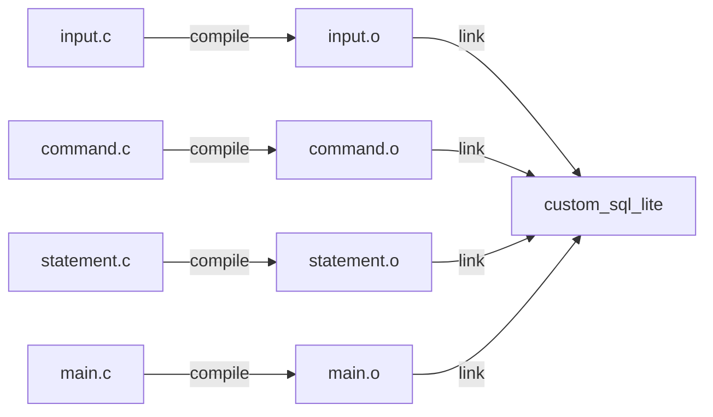
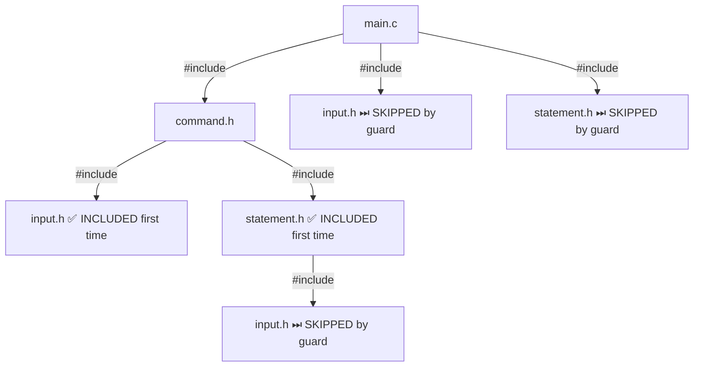
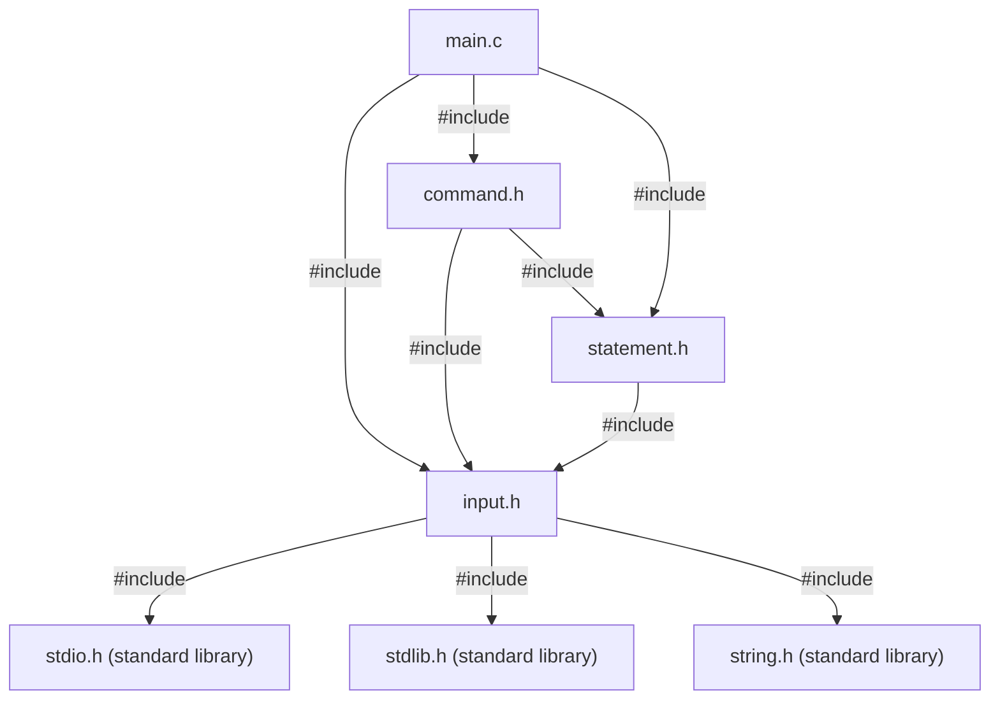
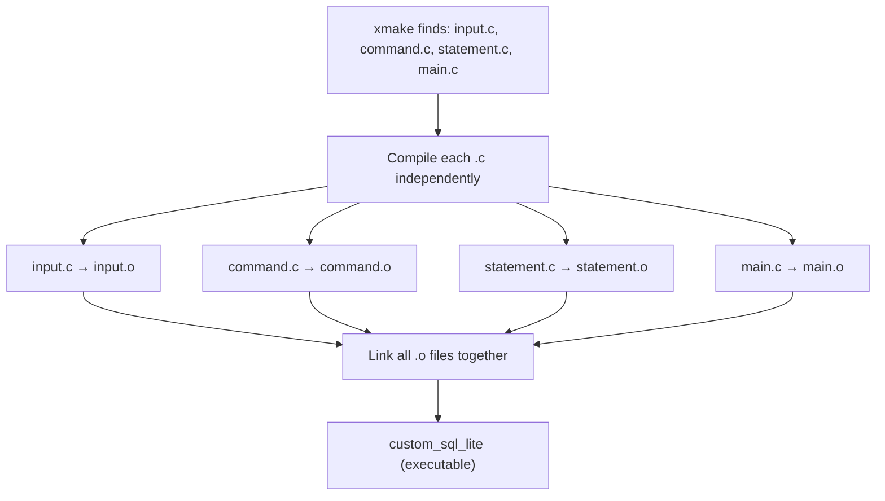
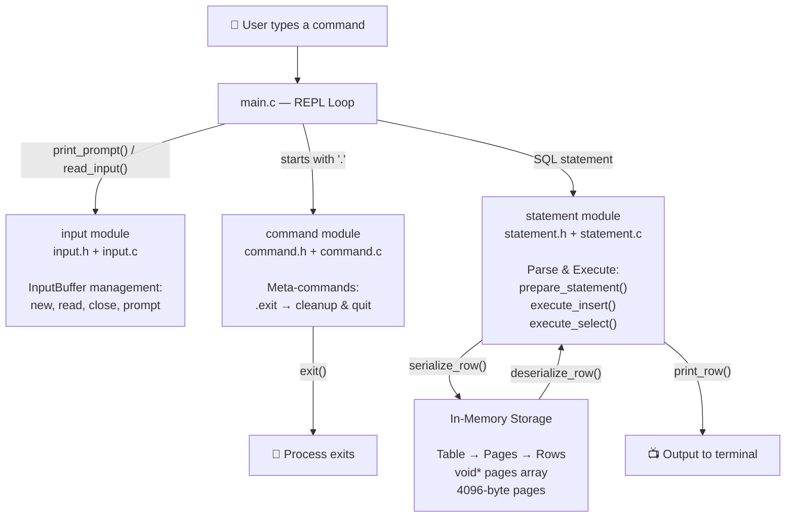
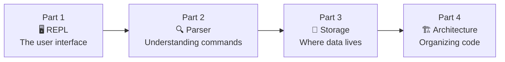

# Part 4 — Architecture: Organizing Your C Project

## What You'll Learn

In this final part of the series, you'll learn:

- Why a C project should be split into multiple files (and what goes wrong if you don't)
- The difference between **header files** (`.h`) and **source files** (`.c`)
- How **include guards** prevent duplicate definitions
- How the **C compilation pipeline** works: `.c` → `.o` → executable
- The critical difference between **declarations** and **definitions**
- How our build tool (**xmake**) orchestrates everything
- A set of practical rules for organizing any C project

---

## 1. Why Split Files?

Imagine a book written as one enormous page — no chapters, no headings, no sections. Finding anything would be a nightmare. Now imagine *multiple people* trying to write that book at the same time, on the same page.

That's what a single-file C program feels like as it grows.

Up through Parts 1–3, we built our entire database in one file: `main.c`. It had the REPL loop, input handling, command parsing, SQL statement preparation, the storage engine, serialization, and more. It *worked*, but it was getting unwieldy.

Splitting code into multiple files gives us four major benefits:

| Benefit | What It Means |
|---|---|
| **Readability** | Each file has a single responsibility. You know exactly where to look. |
| **Maintainability** | Changing the storage engine doesn't risk breaking the input handler. |
| **Faster Compilation** | Change one file? Only that file gets recompiled, not the entire project. |
| **Team Collaboration** | Two developers can work on `input.c` and `statement.c` simultaneously without merge conflicts. |

Here's the file structure we've refactored into:

```
custom_sql_lite/
├── src/
│   ├── main.c          # Entry point — REPL loop only
│   ├── input.c         # InputBuffer: new, read, close, prompt
│   ├── input.h         # InputBuffer type + function declarations
│   ├── command.c       # do_meta_command()
│   ├── command.h       # MetaCommandResult enum + declaration
│   ├── statement.c     # All storage + statement functions
│   └── statement.h     # Row, Table, Statement types + declarations
├── xmake.lua
└── .gitignore
```

Each "module" — input, command, statement — gets a pair of files: a `.h` and a `.c`. Let's understand why.

---

## 2. Header Files (.h) vs Source Files (.c)

This is the most fundamental concept in C project organization. Think of it like a restaurant:

- The **`.h` file is the menu**. It tells you *what's available*: "We have a function called `new_input_buffer()` that returns an `InputBuffer*`." It lists types, constants, and function signatures — but not the actual code.
- The **`.c` file is the kitchen**. It's where the actual cooking happens — the full implementations of those functions.

Why this split? Because **C compiles each `.c` file independently**. When the compiler is working on `main.c` and encounters a call to `new_input_buffer()`, it has never seen `input.c`. It doesn't know that function exists!

The `.h` file solves this. By writing `#include "input.h"` at the top of `main.c`, you're essentially saying: "Hey compiler, trust me — these functions exist. Here are their signatures so you know how to call them."

The compiler takes you at your word. It generates a `.o` **object file** with a placeholder: "call `new_input_buffer` — address TBD." Later, the **linker** finds the actual function in `input.o` and fills in the address.

Here's the entire pipeline:



Each `.c` file is compiled **in isolation** into a `.o` (object) file. Then the **linker** combines all the `.o` files into a single executable.

> [!NOTE]
> A `.o` file (object file) is a chunk of machine code with unresolved references — like a jigsaw puzzle piece. The linker assembles all the pieces into the complete picture.

Let's look at a concrete example. Here's `input.h` — the **menu**:

```c
#ifndef INPUT_H
#define INPUT_H

#include <stdio.h>
#include <stdlib.h>
#include <string.h>

typedef struct {
  char *buffer;
  size_t buffer_length;
  ssize_t input_length;
} InputBuffer;

InputBuffer *new_input_buffer();
void close_input_buffer(InputBuffer *input_buffer);
void read_input(InputBuffer *input_buffer);
void print_prompt();

#endif
```

And here's `input.c` — the **kitchen**:

```c
#include "input.h"

InputBuffer *new_input_buffer() {
  InputBuffer *input_buffer = (InputBuffer *)malloc(sizeof(InputBuffer));
  input_buffer->buffer = NULL;
  input_buffer->buffer_length = 0;
  input_buffer->input_length = 0;
  return input_buffer;
}

void close_input_buffer(InputBuffer *input_buffer) {
  free(input_buffer->buffer);
  free(input_buffer);
}

void print_prompt() { printf("db > "); }

void read_input(InputBuffer *input_buffer) {
  ssize_t bytes_read =
      getline(&(input_buffer->buffer), &(input_buffer->buffer_length), stdin);
  if (bytes_read <= 0) {
    printf("Error reading input\n");
    exit(EXIT_FAILURE);
  }
  input_buffer->input_length = bytes_read - 1;
  input_buffer->buffer[bytes_read - 1] = 0;
}
```

Notice that `input.c` starts with `#include "input.h"`. This is important — the `.c` file includes its own `.h` file. This ensures the function signatures in the header match the actual implementations. If they don't, the compiler catches the mismatch immediately.

> [!TIP]
> Always have your `.c` file include its own `.h` file as the first `#include`. This acts as a self-check: the compiler will catch any inconsistencies between your declarations and definitions.

---

## 3. Include Guards: Preventing Double Inclusion

Look at the top and bottom of `input.h` again:

```c
#ifndef INPUT_H
#define INPUT_H

// ... everything in the header ...

#endif
```

These three lines are called an **include guard**, and they solve a sneaky problem. Let's walk through it.

### The Problem

Look at what `main.c` includes:

```c
#include "command.h"
#include "input.h"
#include "statement.h"
```

Now look at what `command.h` includes:

```c
#include "input.h"
#include "statement.h"
```

And `statement.h` includes:

```c
#include "input.h"
```

See the issue? When the compiler processes `main.c`, the contents of `input.h` get pasted in **three times**:

1. `main.c` → `command.h` → `input.h` ← first copy
2. `main.c` → `command.h` → `statement.h` → `input.h` ← second copy
3. `main.c` → `input.h` ← third copy

Without include guards, the compiler sees the `InputBuffer` struct defined three times and throws an error: *"error: redefinition of 'InputBuffer'."*

### The Solution

Let's trace exactly what the **preprocessor** does with include guards. The preprocessor is the phase that runs *before* the actual compiler — it handles all lines starting with `#`.

**First time `input.h` is encountered:**

1. `#ifndef INPUT_H` — "Is `INPUT_H` **not** defined?" → Yes, it's not defined yet. ✅ Proceed.
2. `#define INPUT_H` — "Define `INPUT_H` as a symbol." Now it exists.
3. All the content (the struct, the function declarations) is included.
4. `#endif` — End of the guard.

**Second time `input.h` is encountered:**

1. `#ifndef INPUT_H` — "Is `INPUT_H` **not** defined?" → No, we defined it last time! ❌ Skip everything.
2. The entire content is skipped until `#endif`.
3. `#endif` — Done.

**Third time: same as the second. Skipped.**

Here's a diagram showing the include chain:



Let's break down each preprocessor keyword used in include guards:

| Keyword | What It Means |
|---|---|
| `#ifndef` | "If **not** defined" — checks if a symbol does NOT exist yet |
| `#define` | Creates a preprocessor symbol (like planting a flag) |
| `#endif` | Closes the `#ifndef` block |

> [!IMPORTANT]
> The guard name (like `INPUT_H`) must be **unique across your entire project**. Convention is `FILENAME_H` in uppercase. If two different headers accidentally use the same guard name, one of them will be silently skipped — a very confusing bug.

### `#pragma once` — The Modern Alternative

Many compilers support `#pragma once` as a simpler alternative:

```c
#pragma once

// ... header contents ...
```

One line instead of three. Here's how they compare:

| Feature | `#ifndef` / `#define` / `#endif` | `#pragma once` |
|---|---|---|
| **Standard C?** | ✅ Yes, works everywhere | ❌ Not in the C standard (but widely supported) |
| **Portability** | Works on every C compiler ever made | Works on GCC, Clang, MSVC, and most modern compilers |
| **Verbosity** | Three lines | One line |
| **Risk of name collision** | Yes (if two files use the same guard name) | No (compiler tracks by file identity) |
| **Our choice** | ✅ We use this | |

We stick with `#ifndef` guards because they're universally portable and standard. But if you're building a personal project and know your compiler supports it, `#pragma once` is perfectly fine.

---

## 4. The Dependency Graph

Now let's zoom out and see how all our files connect. Who includes whom, and why?



Let's trace the dependency logic from the bottom up:

**`input.h`** — The foundation. It depends only on standard library headers (`stdio.h`, `stdlib.h`, `string.h`). It defines the `InputBuffer` type and declares functions to create, read from, and destroy it. It's the most independent module.

**`statement.h`** — Depends on `input.h`. Why? Because `prepare_statement()` takes an `InputBuffer*` parameter. The compiler needs to know what `InputBuffer` looks like, so `statement.h` must include `input.h`. This file defines `Row`, `Table`, `Statement`, and all the storage-related types.

**`command.h`** — Depends on both `input.h` and `statement.h`. Why? Because `do_meta_command()` takes both an `InputBuffer*` and a `Table*` as parameters. It needs to know what both types look like.

**`main.c`** — Includes all three headers. It's the orchestrator that ties everything together in the REPL loop.

> [!NOTE]
> Dependencies flow **downward**: higher-level modules (command, main) depend on lower-level modules (input, statement). The lower-level modules don't know about the higher-level ones. This is good design — it means you could reuse `input.c` in a completely different project without dragging along the rest.

---

## 5. Declarations vs Definitions

This is one of the most critical concepts in C, and it's the key to understanding why the `.h`/`.c` split works.

**Declaration**: Tells the compiler "this thing exists." It describes the *shape* — the name, the types involved — but not the actual *implementation*.

**Definition**: Provides the actual *substance* — the function body, the variable's value, the memory allocation.

Here are examples from our project:

```c
// DECLARATION (in input.h) — "this function exists and returns InputBuffer*"
InputBuffer *new_input_buffer();

// DEFINITION (in input.c) — "here's what it actually does"
InputBuffer *new_input_buffer() {
  InputBuffer *input_buffer = (InputBuffer *)malloc(sizeof(InputBuffer));
  input_buffer->buffer = NULL;
  input_buffer->buffer_length = 0;
  input_buffer->input_length = 0;
  return input_buffer;
}
```

The golden rule:

> **You can declare something as many times as you want. You can define something only ONCE.**

This is called the **One Definition Rule** (ODR). It makes sense if you think about it: declaring a function is like saying "there's a restaurant called Luigi's on Main Street." You can tell a hundred people that. But actually *building* the restaurant? That can only happen once. Two restaurants at the same address would be chaos.

This rule is why the `.h`/`.c` split works so elegantly:

- The `.h` file contains **declarations**. Every `.c` file that includes it gets a copy of the declarations. That's fine — the compiler just needs to know the shapes.
- The `.c` file contains **definitions**. Each definition exists in exactly one file. The linker finds them there.

Here's a comparison table:

| What | Declaration (in `.h`) | Definition (in `.c`) | Can appear multiple times? |
|---|---|---|---|
| **Function** | `void print_row(Row *row);` | `void print_row(Row *row) { printf(...); }` | Declaration: ✅ Yes. Definition: ❌ No. |
| **Struct/Type** | `typedef struct { ... } Row;` | (same — typedef is both) | ✅ Yes (with include guards) |
| **`#define` macro** | `#define PAGE_SIZE 4096` | (same — macros are text substitution) | ✅ Yes (with include guards) |
| **`const` variable** | `extern const uint32_t ROW_SIZE;` | `const uint32_t ROW_SIZE = 291;` | Declaration: ✅ Yes. Definition: ❌ No. |

> [!WARNING]
> Look at our `statement.h` file. It has lines like:
> ```c
> const uint32_t ID_SIZE = size_of_attribute(Row, id);
> const uint32_t ROW_SIZE = ID_SIZE + USERNAME_SIZE + EMAIL_SIZE;
> ```
> These are **definitions**, not declarations! They assign values. Every `.c` file that includes `statement.h` gets its own copy of these variables. This violates the One Definition Rule. It works in our simple project because the compiler may treat `const` globals as internal linkage in C (unlike C++), but it's not ideal practice. We'll discuss how to fix this in the "Could This Be Better?" section below.

---

## 6. How the Build System Works

We use **xmake** as our build tool. Here's our entire `xmake.lua` file:

```lua
add_rules("mode.debug", "mode.release")
target("custom_sql_lite")
    set_kind("binary")
    add_files("src/*.c")
```

That's only four lines, but a lot happens behind the scenes. Let's break it down:

| Line | What It Does |
|---|---|
| `add_rules("mode.debug", "mode.release")` | Enables debug mode (with `-g` for debugging symbols) and release mode (with `-O2` for optimizations) |
| `target("custom_sql_lite")` | Names our build target — the final executable will be called `custom_sql_lite` |
| `set_kind("binary")` | We're building an executable (not a library) |
| `add_files("src/*.c")` | Find all `.c` files in `src/` and compile them |

Here's what xmake does under the hood when you run `xmake`:



If you wanted to do this manually without xmake, here are the equivalent shell commands:

```bash
# Step 1: Compile each .c file into a .o file (the -c flag means "compile only, don't link")
cc -c src/input.c -o build/input.o
cc -c src/command.c -o build/command.o
cc -c src/statement.c -o build/statement.o
cc -c src/main.c -o build/main.o

# Step 2: Link all .o files into the final executable
cc build/input.o build/command.o build/statement.o build/main.o -o custom_sql_lite
```

Let's explain the key flags:

| Flag | Meaning |
|---|---|
| `-c` | **Compile only**. Produce a `.o` object file, don't link. |
| `-o <file>` | **Output**. Name the output file. |
| No `-c` flag (last line) | Without `-c`, the compiler invokes the linker to combine `.o` files into an executable. |

### The Speed Benefit

Here's the payoff of multi-file compilation. Imagine you change just one line in `input.c`. With a single-file project, you'd recompile *everything*. With our multi-file setup:

```bash
# Only recompile the file that changed!
cc -c src/input.c -o build/input.o

# Re-link (fast — just stitching together existing .o files)
cc build/input.o build/command.o build/statement.o build/main.o -o custom_sql_lite
```

The other three `.o` files are untouched. In a project with hundreds of files, this saves *minutes* of build time. Build tools like xmake handle this automatically — they track which files changed and only rebuild what's necessary.

> [!TIP]
> The `-c` flag is worth memorizing. It's the key to understanding C compilation: `cc -c` means "translate this one `.c` file to machine code, but don't try to build a complete program yet."

---

## 7. What Goes in Which File? A Guide

Here's a practical cheat sheet for organizing any C project:

| What | `.h` (Header) | `.c` (Source) | Why? |
|---|---|---|---|
| `#include` guards | ✅ Always | ❌ Never | Only headers get included multiple times |
| `typedef struct { ... }` | ✅ Yes | ❌ No | Other files need to know the type's shape |
| Function declarations | ✅ Yes | ❌ No | Other files need to know the function exists |
| Function definitions (bodies) | ❌ No | ✅ Yes | One Definition Rule — must exist in exactly one place |
| `#define` constants | ✅ Yes | ❌ No | Macros are pure text substitution — no ODR issue |
| `const` variable definitions | ❌ No | ✅ Yes | Putting them in `.h` creates duplicates |
| `extern const` declarations | ✅ Yes | ❌ No | Tells other files "this const exists somewhere" |
| `static` helper functions | ❌ No | ✅ Yes | `static` makes them private to that `.c` file |
| Standard library `#include`s | ✅ If needed by declarations | ✅ If needed by implementations | Include what you use |

A few rules of thumb:

**One module = one `.h` + one `.c`.** The `.h` is the public API. The `.c` is the private implementation. Think of it like a class in object-oriented languages: the `.h` is the interface, the `.c` is the implementation.

**The `.h` file should be self-contained.** If someone includes your `.h`, they shouldn't need to include anything else first. That's why `input.h` includes `<stdio.h>`, `<stdlib.h>`, and `<string.h>` — it needs `size_t` and `ssize_t` from those headers.

**Keep `.h` files minimal.** Only expose what other files actually need. Internal helper functions stay in the `.c` file, marked `static` so they're invisible to the rest of the program.

> [!NOTE]
> The **`static`** keyword on a function in C means "this function is private to this file." It's completely invisible to other `.c` files and the linker. It's like a helper in the kitchen that customers never interact with — not on the menu, not accessible from outside.

---

## 8. The Complete Architecture

Let's step back and see the big picture. Here's how data flows through our entire system:



Here's what each module is responsible for:

| Module | Files | Responsibility | Key Types |
|---|---|---|---|
| **Input** | `input.h`, `input.c` | Read user input, manage the input buffer | `InputBuffer` |
| **Command** | `command.h`, `command.c` | Handle meta-commands (`.exit`) | `MetaCommandResult` |
| **Statement** | `statement.h`, `statement.c` | Parse SQL, execute queries, manage storage | `Row`, `Table`, `Statement`, `PrepareResult`, `ExecuteResult` |
| **Main** | `main.c` | REPL loop — tie everything together | (none — uses types from other modules) |

And here's the simplified `main.c` that orchestrates it all:

```c
#include "command.h"
#include "input.h"
#include "statement.h"
#include <stdbool.h>

int main(int argc, char *argv[]) {
  Table *table = new_table();
  InputBuffer *input_buffer = new_input_buffer();

  while (true) {
    print_prompt();
    read_input(input_buffer);
    if (input_buffer->buffer[0] == '.') {
      switch (do_meta_command(input_buffer, table)) {
      case (META_COMMAND_SUCCESS):
        continue;
      case (META_COMMAND_UNRECOGNIZED_COMMAND):
        printf("Unrecognized command '%s'\n", input_buffer->buffer);
        continue;
      }
    }
    Statement statement;
    switch (prepare_statement(input_buffer, &statement)) {
    case (PREPARE_SUCCESS):
      break;
    case (PREPARE_STRING_TOO_LONG):
      printf("String is too long.\n");
      continue;
    case (PREPARE_NEGATIVE_ID):
      printf("ID must be positive.\n");
      continue;
    case (PREPARE_SYNTAX_ERROR):
      printf("Syntax error. Could not parse statement.\n");
      continue;
    case (PREPARE_UNRECOGNIZED_STATEMENT):
      printf("Unrecognized keyword at start of '%s'.\n", input_buffer->buffer);
      continue;
    }

    switch (execute_statement(&statement, table)) {
    case (EXECUTE_SUCCESS):
      printf("Executed.\n");
      break;
    case (EXECUTE_TABLE_FULL):
      printf("Error: Table full.\n");
      break;
    }
  }
}
```

Look how clean `main.c` is! It reads input, checks if it's a meta-command or a SQL statement, and dispatches accordingly. All the complex logic lives in the other modules. `main.c` is just the conductor of the orchestra.

Let's walk through what those `#include` lines bring in:

- **`#include "command.h"`** — gives us `do_meta_command()` and `MetaCommandResult`. This also transitively includes `input.h` and `statement.h` (since `command.h` includes both), but we include them explicitly for clarity.
- **`#include "input.h"`** — gives us `InputBuffer`, `new_input_buffer()`, `read_input()`, `print_prompt()`, and `close_input_buffer()`.
- **`#include "statement.h"`** — gives us `Table`, `Statement`, `Row`, `new_table()`, `prepare_statement()`, `execute_statement()`, and all the storage types.
- **`#include <stdbool.h>`** — gives us **`bool`** and **`true`**/**`false`** for the `while (true)` loop. This is a standard library header (angle brackets `< >` instead of quotes `" "`).

> [!TIP]
> Use `" "` for your own project headers and `< >` for system/standard library headers. With `" "`, the compiler looks in your project directory first. With `< >`, it looks in the system include paths.

---

## 9. 🔍 Could This Be Better?

Our architecture is a solid foundation, but there are some improvements we'd make in a larger project.

### Issue 1: `statement.h` Is Doing Too Much

Right now, `statement.h` contains SQL parsing types (`Statement`, `PrepareResult`), storage types (`Row`, `Table`), *and* serialization layout constants. That's three responsibilities in one file.

A cleaner split would be:

```
src/
├── table.h / table.c       # Row, Table, serialize, deserialize, pages
├── statement.h / statement.c  # Statement, prepare, execute
├── input.h / input.c        # InputBuffer (unchanged)
├── command.h / command.c    # Meta-commands (unchanged)
└── main.c                   # REPL (unchanged)
```

This way, the **storage engine** (`table`) and the **SQL layer** (`statement`) are independent modules. The statement module would `#include "table.h"` to access `Row` and `Table`.

### Issue 2: `const` Variables in the Header

As we mentioned in Section 5, our `statement.h` has lines like:

```c
const uint32_t ID_SIZE = size_of_attribute(Row, id);
const uint32_t ROW_SIZE = ID_SIZE + USERNAME_SIZE + EMAIL_SIZE;
const uint32_t PAGE_SIZE = 4096;
```

These are **definitions** (they assign values), not just declarations. Every `.c` file that includes `statement.h` gets its own copy. The proper approach:

**In `statement.h`** — declare them with `extern`:
```c
extern const uint32_t ID_SIZE;
extern const uint32_t ROW_SIZE;
extern const uint32_t PAGE_SIZE;
```

**In `statement.c`** — define them once:
```c
const uint32_t ID_SIZE = size_of_attribute(Row, id);
const uint32_t ROW_SIZE = ID_SIZE + USERNAME_SIZE + EMAIL_SIZE;
const uint32_t PAGE_SIZE = 4096;
```

Alternatively, since these are all compile-time constants, you could just use `#define` macros:

```c
#define ID_SIZE sizeof(((Row *)0)->id)
#define PAGE_SIZE 4096
```

Macros are text substitution — they don't create variables, so there's no One Definition Rule issue. The trade-off is that macros don't have types (the compiler won't catch type mismatches), while `const` variables do.

### Issue 3: No `common.h`

As the project grows, you might want a `common.h` that includes shared standard library headers and defines project-wide macros:

```c
#ifndef COMMON_H
#define COMMON_H

#include <stdint.h>
#include <stdio.h>
#include <stdlib.h>
#include <string.h>
#include <stdbool.h>

#endif
```

Then each module's `.h` file just does `#include "common.h"` instead of listing individual standard headers.

### Issue 4: Future Directory Structure

When the project grows to dozens of files, a flat `src/` directory won't cut it. Consider:

```
src/
├── core/
│   ├── input.h / input.c
│   └── command.h / command.c
├── sql/
│   ├── statement.h / statement.c
│   └── parser.h / parser.c
├── storage/
│   ├── table.h / table.c
│   ├── pager.h / pager.c
│   └── btree.h / btree.c
└── main.c
```

This mirrors how real databases like SQLite are structured internally — with clear layers for I/O, SQL parsing, and storage.

---

## 10. Series Recap: What We Built

Let's take a moment to appreciate how far we've come. In four parts, we built a working in-memory database from scratch in C:



| Part | Title | What We Built | Key C Concepts |
|---|---|---|---|
| [**Part 1**](part1-the-repl.md) | REPL | An interactive read-eval-print loop that reads user input and echoes it | `struct`, `malloc`, `getline`, `while(true)`, pointers |
| [**Part 2**](part2-parsing-commands.md) | Parser | Command parsing for meta-commands (`.exit`) and SQL statements (`insert`, `select`) | `enum`, `switch`, `strcmp`, `sscanf`, function pointers |
| [**Part 3**](part3-storing-data.md) | Storage | An in-memory table with page-based storage, serialization, and deserialization | `void*`, `memcpy`, pointer arithmetic, `#define` macros, memory layout |
| **Part 4** | Architecture | A multi-file project with proper headers, include guards, and a build system | `#ifndef`/`#define`/`#endif`, declarations vs definitions, compilation pipeline |

Our database can:
- ✅ Accept user input through an interactive prompt
- ✅ Parse and execute `insert` statements (storing id, username, email)
- ✅ Parse and execute `select` statements (printing all rows)
- ✅ Handle `.exit` to cleanly shut down
- ✅ Store up to ~1,300 rows across 100 in-memory pages
- ✅ Be organized into clean, maintainable modules

### What's Next?

This series covered the fundamentals, but a real database has so much more. Here's what future parts could explore:

| Feature | What It Means |
|---|---|
| **Persistence** | Writing data to disk with file I/O (`fopen`, `fwrite`, `fread`) so data survives restarts |
| **B-Tree Indexing** | A tree data structure for O(log n) lookups instead of scanning every row |
| **Cursor Abstraction** | A pointer-like object that walks through the table, decoupling storage from queries |
| **DELETE and UPDATE** | Modifying existing data, not just inserting and reading |
| **Transactions** | Grouping multiple operations so they either all succeed or all fail |
| **Crash Recovery** | Using a write-ahead log (WAL) to recover from unexpected shutdowns |

Each of these builds on the foundation we've laid. The architecture we set up in this part — with clean module boundaries and a proper build system — means we can add each new feature without rewriting what already works.

---

## Wrapping Up

If you've followed along from Part 1, you've gone from "what's a pointer?" to building a multi-module C project with a working database. That's no small feat.

The architecture patterns we covered today — header/source splits, include guards, the compilation pipeline, the One Definition Rule — aren't specific to databases. They're the foundation of *every* C project, from operating system kernels to embedded firmware to game engines.

You now understand something that many programmers take years to grasp: **how C code is organized, compiled, and linked into a working program.** That knowledge will serve you in every C project you touch.

The database we've built is simple, but it's *real*. It has the same fundamental structure as SQLite — a REPL, a parser, a storage engine, and clean module boundaries. Everything from here is iteration and refinement.

Happy building. 🛠️
